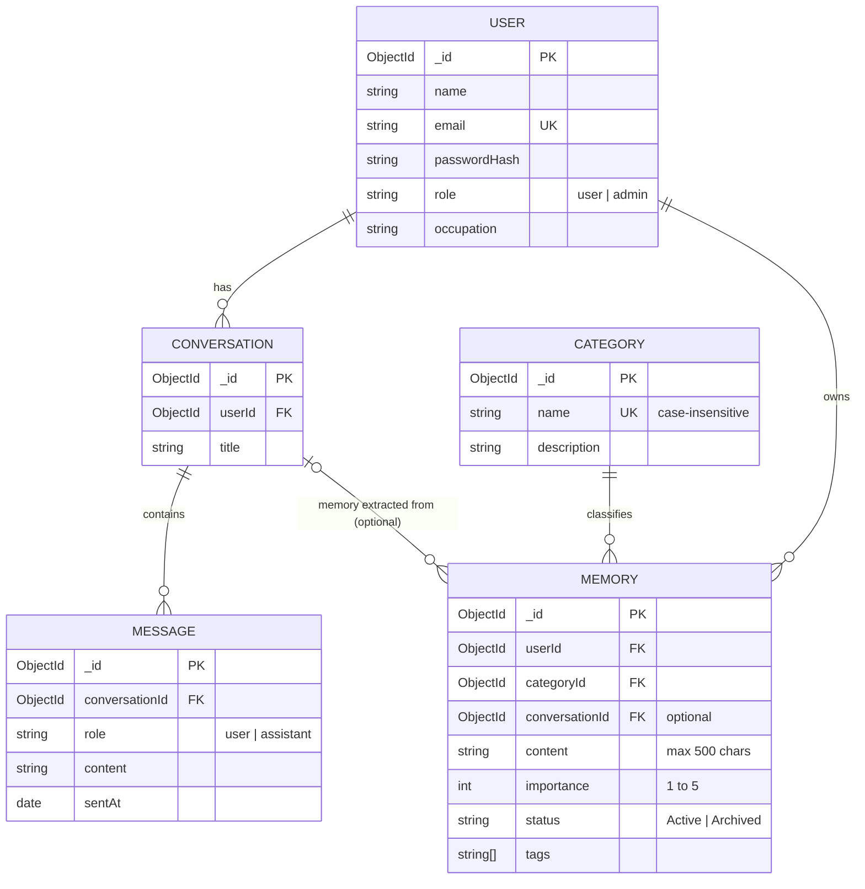

# AI Memory Organizer

A backend that stores what an AI assistant learns about a user ("memories"), organised by category,
linked back to the conversation they came from, and protected by per-user login.
Built with **Node.js, Express and MongoDB (Mongoose)**.

It started as a DBMS course project (CRUD, indexing, aggregation) and is being developed in stages
towards a research project on AI memory as a database problem. See [`docs/ROADMAP.md`](docs/ROADMAP.md).
This README describes the code as of **Stage 1: database hardening**.

## What it does

- **Accounts and login.** Register and log in; passwords are stored as bcrypt hashes; login returns a JWT.
- **Per-user data.** Every memory and conversation query is scoped to the logged-in user. Nobody can read or change another user's data.
- **Memories** with a category, importance (1 to 5), Active/Archived status, tags, and an optional link to the conversation they were extracted from.
- **Conversations and messages**, with messages in their own collection so a long chat never outgrows a document.
- **Referential integrity** enforced in a service layer, because MongoDB has no foreign keys.
- **Cursor pagination** on every list endpoint.
- **Aggregations**: memories per category (`$group` + `$lookup`) and the Active/Archived ratio (`$group` + `$cond`).
- **Indexes** designed with the ESR rule and checked with `explain()`.

## Quick start

You need **Node.js 20+** and **MongoDB 7** (local install, Docker, or an Atlas cluster).

```bash
# 1. MongoDB, if you do not have one running (Docker):
docker run -d --name mongo -p 27017:27017 mongo:7

# 2. Install and configure
npm install
cp .env.example .env        # then set JWT_SECRET to a long random value

# 3. Load sample data (3 users, 4 categories, 5 conversations, 19 messages, 55 memories)
npm run seed

# 4. Start the API on http://localhost:5000
npm start
```

### Sample users

`npm run seed` creates three users. **All of them use the password `DevPassword123`**
(change it with `SEED_PASSWORD`). This is for local development only; never run the seed against a database
with real data, because it deletes everything first.

| Email | Role |
|---|---|
| `aarav.mehta@example.com` | **admin** (can create, rename and delete categories) |
| `priya.nair@example.com` | user |
| `daniel.fernandes@example.com` | user |

### Environment variables

| Variable | Default | Meaning |
|---|---|---|
| `MONGO_URI` | `mongodb://127.0.0.1:27017/aimemory` | Database for the app, the seed and the scripts |
| `MONGO_URI_TEST` | `mongodb://127.0.0.1:27017/aimemory_test` | Database for `npm test`. **The tests drop it**, so never point it at real data |
| `PORT` | `5000` | HTTP port |
| `JWT_SECRET` | insecure dev value | Signs login tokens. **Required when `NODE_ENV=production`** |
| `JWT_EXPIRES_IN` | `7d` | Token lifetime |
| `BCRYPT_ROUNDS` | `10` | bcrypt cost factor |
| `SEED_PASSWORD` | `DevPassword123` | Password of the seeded users |
| `MIGRATE_DEFAULT_PASSWORD` | unset | Used by `npm run migrate` for old users without a password |

### npm scripts

| Command | What it does |
|---|---|
| `npm start` | Start the API |
| `npm run dev` | Start with automatic restart on file changes |
| `npm run seed` | Empty the database and load the sample data |
| `npm test` | Run the test suite (needs MongoDB, see [Tests](#tests)) |
| `npm run explain` | Print the indexes and the query plan of the main queries |
| `npm run migrate` | Upgrade a database created before Stage 1 (see [Upgrading an old database](#upgrading-an-old-database)) |

## Using the API

Everything except `/api/auth/*` and `GET /` needs the header `Authorization: Bearer <token>`.

```bash
# Log in and keep the token
TOKEN=$(curl -s -X POST http://localhost:5000/api/auth/login \
  -H 'Content-Type: application/json' \
  -d '{"email":"priya.nair@example.com","password":"DevPassword123"}' | node -pe 'JSON.parse(require("fs").readFileSync(0)).token')

# Her Health memories, 2 per page
curl -s "http://localhost:5000/api/memories?category=health&limit=2" -H "Authorization: Bearer $TOKEN"
```

### Endpoints

| Method and path | Purpose |
|---|---|
| `POST /api/auth/register` | Create an account. Body: `{ name, email, password, occupation? }`. Returns `201 { user, token }` |
| `POST /api/auth/login` | Body: `{ email, password }`. Returns `{ user, token }` |
| `GET /api/users/me` | Your account (`me` or your own id; anyone else's id is `403`) |
| `PUT /api/users/me` | Update `name`, `email`, `occupation`, or `password` (changing it also needs `currentPassword`) |
| `DELETE /api/users/me` | Delete your account and, in cascade, your conversations, messages and memories |
| `GET /api/categories`, `GET /api/categories/:id` | Read the shared categories (any user) |
| `POST /api/categories`, `PUT /api/categories/:id`, `DELETE /api/categories/:id` | Change categories (**admin only**). Delete is `409` while any memory uses the category |
| `GET /api/conversations` | Your conversations, newest first |
| `POST /api/conversations` | Body: `{ title }` |
| `GET /api/conversations/:id` | One conversation, with `messageCount` |
| `PUT /api/conversations/:id` | Body: `{ title }` |
| `DELETE /api/conversations/:id` | Delete it and its messages. Memories made from it are kept, with the link removed |
| `GET /api/conversations/:id/messages` | Messages in chat order |
| `POST /api/conversations/:id/messages` | Body: `{ role: "user" \| "assistant", content }` |
| `POST /api/memories` | Body: `{ content, category` (name) `or categoryId, importance?, status?, tags?, conversationId? }`. Returns `201` |
| `GET /api/memories` | Your memories, newest first. Filters: `status`, `category`, `categoryId`, `minImportance` |
| `GET /api/memories/:id` | One memory |
| `PUT /api/memories/:id` | Change any of `content`, `category`/`categoryId`, `importance`, `status`, `tags`, `conversationId` (`null` unlinks) |
| `DELETE /api/memories/:id` | Delete one memory |
| `GET /api/memories/stats/by-category` | Count, active count and average importance per category |
| `GET /api/memories/stats/status-ratio` | Active vs Archived: counts, percentages, ratio |
| `GET /api/memories/search?q=` | Keyword search over content and tags, ranked by relevance. Takes `limit` but no `cursor` |

`GET /` returns this list as JSON.

### Pagination

List endpoints return `{ count, limit, nextCursor, <items> }` (the items are under `memories`,
`conversations`, `messages` or `categories`).

- `?limit=` is a whole number from 1 to 100 (default 20). Larger values are capped at 100, and the response
  shows the limit that was used. `0`, negative or non-numeric values are a `400`.
- `?cursor=` is the `nextCursor` of the previous page. `nextCursor` is `null` on the last page.
- The cursor is the `_id` of the last item (keyset pagination). Unlike `skip`/`limit`, a page does not shift if
  items are added or deleted between requests, and deep pages are as cheap as the first.
- Memories, conversations and categories are ordered by `_id` (newest first, except categories: oldest first).
  Messages are ordered by `sentAt` (chat order).
- Search is the one exception: results are ranked by relevance, which is not the `_id` order, so it returns the
  top `limit` matches without a cursor.

### Errors

Errors are `{ "error": "message" }`.

| Status | Meaning |
|---|---|
| `400` | Invalid input: validation failed, malformed id, unknown category or conversation, bad query parameter |
| `401` | Missing, invalid or expired token, or wrong email/password |
| `403` | Not allowed: another user's account, or a non-admin changing categories |
| `404` | Not found. Another user's memory or conversation is also `404`, so ids of other users' data cannot be probed |
| `409` | Conflict: duplicate email or category name, or deleting a category that is still in use |

## Data model



### Referential integrity (no foreign keys in MongoDB)

All checks are in `services/`, so they apply to every route.

| Rule | Behaviour |
|---|---|
| A memory needs an existing category | `400 Unknown category` on create and update |
| A memory's conversation must exist **and be yours** | `400 Unknown conversationId` on create and update |
| A message needs one of **your** conversations | `404` otherwise |
| Delete a category that has memories | `409`, nothing is deleted |
| Delete a conversation | Its messages are deleted. Its memories are kept and unlinked |
| Delete a user | Their memories, messages and conversations are deleted first, the user last |

Cascades are not wrapped in a transaction (a standalone MongoDB server has none). The parent is always removed
last, so if a request fails half-way the parent still exists and the request can simply be repeated.

## Indexes

Designed with the **ESR rule** (index **E**quality fields first, then the **S**ort field, then **R**ange fields)
and verified with `npm run explain`. Every list is paginated newest-first on `_id`, so `_id` is the sort key.

| Collection | Index | Serves | ESR |
|---|---|---|---|
| memories | `{ userId, _id: -1 }` | A user's memories; also the `$match` of both aggregations | E: userId, S: _id |
| memories | `{ userId, status, _id: -1 }` | Active / Archived list | E: userId, status, S: _id |
| memories | `{ userId, categoryId, _id: -1 }` | List by category | E: userId, categoryId, S: _id |
| memories | `{ categoryId }` | "Does this category still have memories?" (crosses users, so no userId prefix) | E: categoryId |
| memories | `{ userId, content: text, tags: text }` | Keyword search, kept inside one user's data | E: userId |
| conversations | `{ userId, _id: -1 }` | A user's conversations | E: userId, S: _id |
| messages | `{ conversationId, sentAt }` | One conversation in chat order | E: conversationId, S: sentAt |
| users | `{ email }` unique | Login, duplicate check | E: email |
| categories | `{ name }` unique, case-insensitive | Duplicate check, lookup by name | E: name |

Deliberately **not** indexed: `userId` alone (a prefix of the compound indexes above) and `status` alone
(only two values, so it filters almost nothing). `minImportance` is a range on a field that is not in an index; it is
applied while documents are fetched.

Each index makes writes a little slower and uses memory, so each one above exists for a query the API actually runs.

`npm run explain` prints the plan of each of those queries and exits with an error on a duplicate index or a
collection scan (`COLLSCAN`). Example (seeded data):

```
memories: list newest first
  plan:     LIMIT -> FETCH -> IXSCAN(userId_1__id_-1)
  returned: 20, keys examined: 20, docs examined: 20
```

The messages query shows a `SORT` stage: the tie-break on `_id` (needed so messages with the same timestamp
paginate in a stable order) is not part of the index. It only sorts one conversation's messages, so it stays small.
Adding `_id` as a third key of that index would remove it.

## Upgrading an old database

If you have a database created by the earlier (DBMS review) version, run once:

```bash
npm run migrate
```

It is safe to run more than once. It drops the old indexes (standalone `userId` and `status`, the old compound,
text and conversation indexes), builds the new ones, moves messages embedded in conversation documents into the
`messages` collection, and lists users who have no password yet. Those users cannot log in until they get one:
set `MIGRATE_DEFAULT_PASSWORD` to give all of them the same temporary password, and ask them to change it.

Starting the app on an old database without migrating does not crash, but the old indexes stay (the old text
index even blocks the new search index; the server prints a warning telling you to run `npm run migrate`) and
old conversations show no messages.

## Tests

Tests use **Jest and supertest against a real MongoDB** (no mocks), so MongoDB must be running.

```bash
docker run -d --name mongo -p 27017:27017 mongo:7   # if not already running
npm test
```

`npm test` runs the files one after another (`--runInBand`) because they share one database
(`MONGO_URI_TEST`, default `aimemory_test`), which is **dropped and recreated**. They cover CRUD, validation errors,
referential integrity, login and token handling, user isolation (user A cannot see or change user B's data),
pagination, both aggregations (including the orphan-category fix), text search, index design with `explain()`,
and the migration.

GitHub Actions runs the same tests on every push and pull request against a `mongo:7` service container,
then seeds a database and runs `npm run explain` as a smoke test (`.github/workflows/ci.yml`).

## Project structure

```
app.js              Express app (middleware, routes, error handler); imported by tests
index.js            Connects to MongoDB and starts the server
models/             Mongoose schemas and indexes
services/           Business logic: integrity checks, scoping, cascades, aggregations, pagination, auth
routes/             Thin HTTP layer over the services
middleware/         JWT authentication, admin check, async error forwarding
scripts/            explain.js (query plans), migrate-stage1.js
seed.js             Sample data
tests/              Jest + supertest tests
docs/               Roadmap and prompt playbook for the staged development
```

## Known limitations (Stage 1)

- **Login only.** There is no password reset, email verification, refresh token or rate limiting on login.
  Do not expose it to the internet as it is.
- **Categories are shared** by all users and only admins can change them. The first admin has to be set in the
  database (the seed makes Aarav one); nobody can become admin through the API.
- **Deleting a conversation keeps its memories.** Removing everything derived from a conversation is planned for Stage 7.
- **Cascade deletes are not atomic** (see above). Stage 2 moves to a replica set, which allows transactions.
- **Search matches words, not meaning** ("nut allergy" will not find "allergic to peanuts"). Semantic search is planned for Stage 4.
