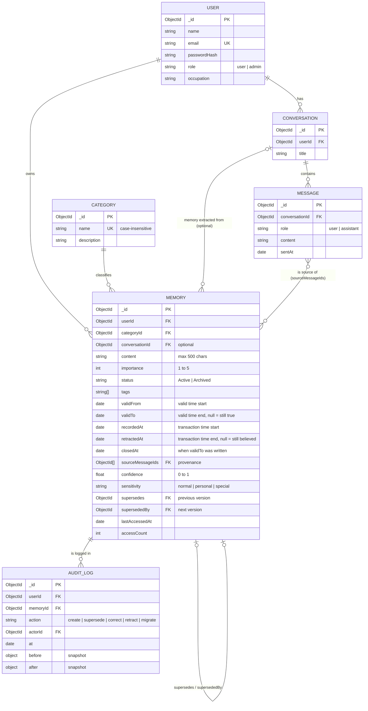

# AI Memory Organizer

A backend that stores what an AI assistant learns about a user ("memories"), organised by category,
linked back to the conversation they came from, and protected by per-user login.
Built with **Node.js, Express and MongoDB (Mongoose)**.

It started as a DBMS course project (CRUD, indexing, aggregation) and is being developed in stages
towards a research project on AI memory as a database problem. See [`docs/ROADMAP.md`](docs/ROADMAP.md).
This README describes the code as of **Stage 2: bi-temporal memory schema**.

## What it does

- **Accounts and login.** Register and log in; passwords are stored as bcrypt hashes; login returns a JWT.
- **Per-user data.** Every memory and conversation query is scoped to the logged-in user. Nobody can read or change another user's data.
- **Memories** with a category, importance (1 to 5), Active/Archived status, tags, and an optional link to the conversation they were extracted from.
- **Conversations and messages**, with messages in their own collection so a long chat never outgrows a document.
- **Referential integrity** enforced in a service layer, because MongoDB has no foreign keys.
- **Cursor pagination** on every list endpoint.
- **Aggregations**: memories per category (`$group` + `$lookup`) and the Active/Archived ratio (`$group` + `$cond`).
- **Indexes** designed with the ESR rule and checked with `explain()`.
- **Bi-temporal memories** (Stage 2). A memory is a chain of versions. Each version records when the fact was
  true (*valid time*) and when the database believed it (*transaction time*). Updates never overwrite: they
  supersede the old version inside a transaction. You can ask what was true at any date (`?asOf=`) and what the
  database believed at any moment (`?knownAt=`). See [Bi-temporal memories](#bi-temporal-memories).
- **Provenance and an audit log.** Each memory can cite the messages it came from (`sourceMessageIds`). Every
  create, supersede, correction and delete is written to an append-only `auditlog` collection.

## Quick start

You need **Node.js 20+** and **MongoDB 7 running as a replica set** (a single node is enough). Changes to memories
run in transactions, and MongoDB only has transactions on a replica set. Atlas clusters already are one.

```bash
# 1. MongoDB as a single-node replica set, if you do not have one running (Docker):
docker run -d --name mongo -p 27017:27017 mongo:7 --replSet rs0
docker exec mongo mongosh --quiet --eval "rs.initiate({_id: 'rs0', members: [{_id: 0, host: 'localhost:27017'}]})"

# 2. Install and configure
npm install
cp .env.example .env        # then set JWT_SECRET to a long random value

# 3. Load sample data (3 users, 4 categories, 5 conversations, 19 messages, 61 memory versions of which 58 are current)
npm run seed

# 4. Start the API on http://localhost:5000
npm start
```

### Run MongoDB as a replica set

A replica set is a group of MongoDB servers that keep copies of the same data. One server on its own can still be
a replica set ("single-node"). That is all transactions need. It is a one-time setup:

- **Docker:** the two commands in the Quick start above.
- **MongoDB installed as a Windows service:** step-by-step PowerShell commands are in
  [`docs/stages/STAGE-2.md`](docs/stages/STAGE-2.md#demo-on-your-laptop). In short: add
  `replication:` / `  replSetName: rs0` to `mongod.cfg`, restart the `MongoDB` service, then run
  `mongosh --eval "rs.initiate()"` once.
- **Linux / macOS install:** add the same two lines to `/etc/mongod.conf` (or `/opt/homebrew/etc/mongod.conf`),
  restart `mongod`, then run `mongosh --eval "rs.initiate()"` once.

Check it with `mongosh --quiet --eval "rs.status().ok"` (prints `1`). The connection string does not change.
If MongoDB is not a replica set, `npm start` prints a warning, reads still work, writes to memories return `503`,
and `npm test` stops with a message pointing here.

### Sample users

`npm run seed` creates three users. **All of them use the password `DevPassword123`**
(change it with `SEED_PASSWORD`). This is for local development only; never run the seed against a database
with real data, because it deletes everything first.

| Email | Role |
|---|---|
| `aarav.mehta@example.com` | **admin** (can create, rename and delete categories) |
| `priya.nair@example.com` | user |
| `daniel.fernandes@example.com` | user |

### Environment variables

| Variable | Default | Meaning |
|---|---|---|
| `MONGO_URI` | `mongodb://127.0.0.1:27017/aimemory` | Database for the app, the seed and the scripts |
| `MONGO_URI_TEST` | `mongodb://127.0.0.1:27017/aimemory_test` | Database for `npm test`. **The tests drop it**, so never point it at real data |
| `PORT` | `5000` | HTTP port |
| `JWT_SECRET` | insecure dev value | Signs login tokens. **Required when `NODE_ENV=production`** |
| `JWT_EXPIRES_IN` | `7d` | Token lifetime |
| `BCRYPT_ROUNDS` | `10` | bcrypt cost factor |
| `SEED_PASSWORD` | `DevPassword123` | Password of the seeded users |
| `MIGRATE_DEFAULT_PASSWORD` | unset | Used by `npm run migrate` for old users without a password |

### npm scripts

| Command | What it does |
|---|---|
| `npm start` | Start the API |
| `npm run dev` | Start with automatic restart on file changes |
| `npm run seed` | Empty the database and load the sample data |
| `npm test` | Run the test suite (needs MongoDB, see [Tests](#tests)) |
| `npm run explain` | Print the indexes and the query plan of the main queries |
| `npm run migrate` | Upgrade an older database to the current schema: runs the Stage 1 and Stage 2 migrations in order (see [Upgrading an old database](#upgrading-an-old-database)) |

## Using the API

Everything except `/api/auth/*` and `GET /` needs the header `Authorization: Bearer <token>`.

```bash
# Log in and keep the token
TOKEN=$(curl -s -X POST http://localhost:5000/api/auth/login \
  -H 'Content-Type: application/json' \
  -d '{"email":"priya.nair@example.com","password":"DevPassword123"}' | node -pe 'JSON.parse(require("fs").readFileSync(0)).token')

# Her Health memories, 2 per page
curl -s "http://localhost:5000/api/memories?category=health&limit=2" -H "Authorization: Bearer $TOKEN"
```

### Endpoints

| Method and path | Purpose |
|---|---|
| `POST /api/auth/register` | Create an account. Body: `{ name, email, password, occupation? }`. Returns `201 { user, token }` |
| `POST /api/auth/login` | Body: `{ email, password }`. Returns `{ user, token }` |
| `GET /api/users/me` | Your account (`me` or your own id; anyone else's id is `403`) |
| `PUT /api/users/me` | Update `name`, `email`, `occupation`, or `password` (changing it also needs `currentPassword`) |
| `DELETE /api/users/me` | Delete your account and, in one transaction, your conversations, messages, every memory version and your audit log entries |
| `GET /api/categories`, `GET /api/categories/:id` | Read the shared categories (any user) |
| `POST /api/categories`, `PUT /api/categories/:id`, `DELETE /api/categories/:id` | Change categories (**admin only**). Delete is `409` while any memory version that is not retracted (current or past) uses the category |
| `GET /api/conversations` | Your conversations, newest first |
| `POST /api/conversations` | Body: `{ title }` |
| `GET /api/conversations/:id` | One conversation, with `messageCount` |
| `PUT /api/conversations/:id` | Body: `{ title }` |
| `DELETE /api/conversations/:id` | Delete it and its messages. Memories made from it are kept, with the links to the conversation and to the deleted messages removed |
| `GET /api/conversations/:id/messages` | Messages in chat order |
| `POST /api/conversations/:id/messages` | Body: `{ role: "user" \| "assistant", content }` |
| `POST /api/memories` | Body: `{ content, category` (name) `or categoryId, importance?, status?, tags?, conversationId?, validFrom?, confidence?, sensitivity?, sourceMessageIds? }`. Returns `201` with the first version |
| `GET /api/memories` | Your **current** memories, newest first. Filters: `status`, `category`, `categoryId`, `minImportance`. Time travel: `asOf` (valid time) and/or `knownAt` (transaction time), ISO dates |
| `GET /api/memories/:id` | One version (current or past; a retracted one is `404`). Counts as an access (`accessCount`, `lastAccessedAt`) |
| `GET /api/memories/:id/history` | The whole version chain, oldest first, from any of its versions |
| `PUT /api/memories/:id` | **Supersede**: creates a new version and closes this one; returns the new version. Any of `content`, `category`/`categoryId`, `importance`, `status`, `tags`, `conversationId` (`null` unlinks), `confidence`, `sensitivity`, `sourceMessageIds`, `validFrom` (when the change happened; default now). Send `"correction": true` to fix a mistake instead. Only the current version can be updated (`409` otherwise) |
| `DELETE /api/memories/:id` | **Retract** one version: it disappears from current results but stays in the history |
| `GET /api/audit` | Your audit log, newest first. Filter: `memoryId` |
| `GET /api/memories/stats/by-category` | Count, active count and average importance per category (current versions) |
| `GET /api/memories/stats/status-ratio` | Active vs Archived: counts, percentages, ratio (current versions) |
| `GET /api/memories/search?q=` | Keyword search over the content and tags of current versions, ranked by relevance. Takes `limit` but no `cursor` |

`GET /` returns this list as JSON.

### Pagination

List endpoints return `{ count, limit, nextCursor, <items> }` (the items are under `memories`,
`conversations`, `messages` or `categories`).

- `?limit=` is a whole number from 1 to 100 (default 20). Larger values are capped at 100, and the response
  shows the limit that was used. `0`, negative or non-numeric values are a `400`.
- `?cursor=` is the `nextCursor` of the previous page. `nextCursor` is `null` on the last page.
- The cursor is the `_id` of the last item (keyset pagination). Unlike `skip`/`limit`, a page does not shift if
  items are added or deleted between requests, and deep pages are as cheap as the first.
- Memories, conversations and categories are ordered by `_id` (newest first, except categories: oldest first).
  Messages are ordered by `sentAt` (chat order).
- Search is the one exception: results are ranked by relevance, which is not the `_id` order, so it returns the
  top `limit` matches without a cursor.

### Errors

Errors are `{ "error": "message" }`.

| Status | Meaning |
|---|---|
| `400` | Invalid input: validation failed, malformed id, unknown category or conversation, bad query parameter |
| `401` | Missing, invalid or expired token, or wrong email/password |
| `403` | Not allowed: another user's account, or a non-admin changing categories |
| `404` | Not found. Another user's memory or conversation is also `404`, so ids of other users' data cannot be probed |
| `409` | Conflict: duplicate email or category name, or deleting a category that is still in use |

## Bi-temporal memories

People change: they move city, change goals, and sometimes the assistant simply got a fact wrong. Overwriting a
memory loses what was believed before; deleting it loses that it was ever true. Since Stage 2 every memory is a
**chain of versions**, and every version carries two time intervals:

| Axis | Fields | Question it answers | Who sets it |
|---|---|---|---|
| **Valid time** | `validFrom`, `validTo` | When was the fact true in the user's life? | The client may backdate `validFrom` (never in the future). `validTo` is set when the fact is superseded |
| **Transaction time** | `recordedAt`, `retractedAt` | When did the database believe this version? | Always the server clock |

`validTo = null` means "still true"; `retractedAt = null` means "still believed". A **current** version has both
null. Intervals are half-open: a version is valid from `validFrom` up to, but not including, `validTo`.
`closedAt` records the transaction time at which `validTo` was written, so `knownAt` queries show `validTo` as it
was known then.

Three kinds of change, each one transaction that also writes the audit log:

| Request | What happens | Audit action |
|---|---|---|
| `PUT /api/memories/:id` | **Supersede**: the fact changed. The old version gets `validTo` = the new `validFrom` and `supersededBy`; a new version is inserted with `supersedes` | `supersede` |
| `PUT` with `"correction": true` | **Correction**: the old version was wrong all along. It is retracted (`retractedAt`); the new version takes over its valid time | `correct` |
| `DELETE /api/memories/:id` | **Retraction**: we no longer believe this version. Nothing is physically deleted (hard erasure comes in Stage 7) | `retract` |

### Worked example (seeded user Priya)

Priya lived in Kochi from June 2019. The assistant first recorded this on 10 Feb 2023. She moved to Bengaluru
on 1 Aug 2024, but the assistant only learned it on 20 Aug 2024. The seed stores two versions:

| Version | content | validFrom | validTo | recordedAt | retractedAt |
|---|---|---|---|---|---|
| v1 | User lives in Kochi with their parents. | 2019-06-01 | **2024-08-01** | 2023-02-10 | null |
| v2 | User moved from Kochi to Bengaluru ... | 2024-08-01 | null | 2024-08-20 | null |

| Query | Answer | Why |
|---|---|---|
| `GET /api/memories` | v2 (Bengaluru) | the current version |
| `?asOf=2023-06-01` | v1 (Kochi) | valid time: what was true then, as we know it today |
| `?asOf=2024-08-10` | v2 (Bengaluru) | she had already moved on 10 Aug |
| `?asOf=2024-08-10&knownAt=2024-08-15` | **v1 (Kochi)** | on 15 Aug we had not been told about the move yet |
| `?knownAt=2022-01-01` | nothing about her city | the database knew nothing before 10 Feb 2023 |
| `GET /api/memories/<v1 or v2>/history` | v1 then v2 | the version chain, followed with `$graphLookup` |

The two axes disagree exactly when the database learns about a change late (or a mistake is corrected), which is
why both are kept. The seed also has a changed goal (Daniel) and a corrected mistake (Aarav's placement month).

```bash
curl -s "http://localhost:5000/api/memories?asOf=2024-08-10&knownAt=2024-08-15&category=personal" -H "Authorization: Bearer $TOKEN"
```

## Data model



Health memories default to sensitivity `special` (special-category data in GDPR Art. 9; the legal mapping is
Stage 7). The audit log is append-only: the model refuses updates and single deletes. Deleting a whole account is
the one case where entries are removed, together with everything else about that person.

### Referential integrity (no foreign keys in MongoDB)

All checks are in `services/`, so they apply to every route.

| Rule | Behaviour |
|---|---|
| A memory needs an existing category | `400 Unknown category` on create and update |
| A memory's conversation must exist **and be yours** | `400 Unknown conversationId` on create and update |
| Every `sourceMessageIds` entry must be a message in **your** conversations | `400 Unknown sourceMessageIds` |
| A version can be superseded only once | `409`; the unique index on `supersedes` makes a forked chain impossible |
| A message needs one of **your** conversations | `404` otherwise |
| Delete a category that a believed (not retracted) version uses | `409`, nothing is deleted |
| Delete a conversation | Its messages are deleted. Its memory versions are kept, unlinked from it and from the deleted messages |
| Delete a user | Their memory versions, audit entries, messages, conversations and the user are deleted |

Since Stage 2 every multi-document change (create/supersede/retract plus its audit entry, and the cascades above)
runs in a **transaction**: either all of it is saved or none of it.

## Indexes

Designed with the **ESR rule** (index **E**quality fields first, then the **S**ort field, then **R**ange fields)
and verified with `npm run explain`. Every list is paginated newest-first on `_id`, so `_id` is the sort key.

| Collection | Index | Serves | ESR |
|---|---|---|---|
| memories | `{ userId, validTo, retractedAt, _id: -1 }` | Current memories; also the `$match` of both aggregations | E: userId, validTo = null, retractedAt = null, S: _id |
| memories | `{ userId, validTo, retractedAt, status, _id: -1 }` | Current Active / Archived list | E: userId, validTo, retractedAt, status, S: _id |
| memories | `{ userId, validTo, retractedAt, categoryId, _id: -1 }` | Current list by category | E: userId, validTo, retractedAt, categoryId, S: _id |
| memories | `{ userId, _id: -1, validFrom, recordedAt }` | `?asOf=` / `?knownAt=` time travel | E: userId, S: _id, R: validFrom, recordedAt |
| memories | `{ categoryId, retractedAt }` | "Does a believed version still use this category?" (crosses users, so no userId prefix) | E: categoryId, retractedAt = null |
| memories | `{ supersedes }` unique, partial | Guarantees a version has at most one successor | E: supersedes |
| memories | `{ userId, content: text, tags: text }` | Keyword search, kept inside one user's data | E: userId |
| auditlog | `{ userId, _id: -1 }` | Your audit log, newest first | E: userId, S: _id |
| auditlog | `{ userId, memoryId, _id: -1 }` | The log of one version | E: userId, memoryId, S: _id |
| conversations | `{ userId, _id: -1 }` | A user's conversations | E: userId, S: _id |
| messages | `{ conversationId, sentAt }` | One conversation in chat order | E: conversationId, S: sentAt |
| users | `{ email }` unique | Login, duplicate check | E: email |
| categories | `{ name }` unique, case-insensitive | Duplicate check, lookup by name | E: name |

"Current" is written as the **equality** `validTo: null, retractedAt: null`, not as a range on dates, so it
can sit in the equality part of an index. The time-travel index puts its ranges *after* the sort key: the scan
stays in `_id` order (no in-memory `SORT`) and versions that started after the asked time are skipped on the index
keys alone, before any document is fetched (`npm run explain` shows fewer documents examined than keys).
The history endpoint follows the chain with `$graphLookup`; each hop is a lookup on `_id`.

Deliberately **not** indexed: `userId` alone (a prefix of the compound indexes above) and `status` alone
(only two values, so it filters almost nothing). `minImportance` is a range on a field that is not in an index; it is
applied while documents are fetched.

Each index makes writes a little slower and uses memory, so each one above exists for a query the API actually runs.

`npm run explain` prints the plan of each of those queries and exits with an error on a duplicate index or a
collection scan (`COLLSCAN`). Example (seeded data):

```
memories: ?asOf= (valid time)
  plan:     LIMIT -> FETCH -> IXSCAN(userId_1__id_-1_validFrom_1_recordedAt_1)
  returned: 1, keys examined: 23, docs examined: 2
```

The query planner picks whichever usable index answers fastest on the data at hand, so on a small seeded database
the current-state list may also be served by the time-travel index. Either way there is no `COLLSCAN` and no `SORT`.

On MongoDB 8 the simple lookups by one field (login by email, "is this category in use?") are reported as
`EXPRESS_IXSCAN` instead of `IXSCAN`. That is MongoDB's faster path for these queries and it still uses the index.

The messages query shows a `SORT` stage: the tie-break on `_id` (needed so messages with the same timestamp
paginate in a stable order) is not part of the index. It only sorts one conversation's messages, so it stays small.
Adding `_id` as a third key of that index would remove it.

## Upgrading an old database

If you have a database created by an earlier version (the DBMS review version or Stage 1), run once:

```bash
npm run migrate
```

It is safe to run more than once. It drops the old indexes (standalone `userId` and `status`, the old compound,
text and conversation indexes), builds the new ones, moves messages embedded in conversation documents into the
`messages` collection, and lists users who have no password yet. Those users cannot log in until they get one:
set `MIGRATE_DEFAULT_PASSWORD` to give all of them the same temporary password, and ask them to change it.

The Stage 2 part (`scripts/migrate-stage2.js`) turns every memory into a current first version:
`validFrom = recordedAt = createdAt` (or the time inside its `_id` when `createdAt` is missing), `validTo`,
`retractedAt` and the links null, `confidence` 1, sensitivity `special` for Health and `normal` otherwise. It
replaces the Stage 1 memory indexes with the Stage 2 ones and writes a `migrate` entry to the audit log for each
memory, in the same transaction. Values that are already there are never overwritten, and a second run converts
nothing. It needs the replica set.

Starting the app on an old database without migrating does not crash, but the old indexes stay (the old text
index even blocks the new search index; the server prints a warning telling you to run `npm run migrate`) and
old conversations show no messages.

## Tests

Tests use **Jest and supertest against a real MongoDB** (no mocks), so MongoDB must be running **as a replica set**
(see [Run MongoDB as a replica set](#run-mongodb-as-a-replica-set)).

```bash
# if not already running
docker run -d --name mongo -p 27017:27017 mongo:7 --replSet rs0
docker exec mongo mongosh --quiet --eval "rs.initiate({_id: 'rs0', members: [{_id: 0, host: 'localhost:27017'}]})"
npm test
```

`npm test` runs the files one after another (`--runInBand`) because they share one database
(`MONGO_URI_TEST`, default `aimemory_test`), which is **dropped and recreated**. They cover CRUD, validation errors,
referential integrity, login and token handling, user isolation (user A cannot see or change user B's data),
pagination, both aggregations (including the orphan-category fix), text search, index design with `explain()`,
both migrations, and (Stage 2, `tests/temporal.test.js`) supersede, correction, retraction, history, `asOf` vs
`knownAt`, the audit log, concurrent updates, and transaction rollback when a step fails half-way.

GitHub Actions runs the same tests on every push and pull request (Node 20 and 22 on MongoDB 7, and Node 22 on
MongoDB 8) against MongoDB started in Docker as a single-node replica set, then seeds a database, runs
`npm run migrate` (which must be a no-op) and `npm run explain` as a smoke test (`.github/workflows/ci.yml`).

## Project structure

```
app.js              Express app (middleware, routes, error handler); imported by tests
index.js            Connects to MongoDB and starts the server
models/             Mongoose schemas and indexes
services/           Business logic: integrity checks, scoping, cascades, aggregations, pagination, auth
routes/             Thin HTTP layer over the services
middleware/         JWT authentication, admin check, async error forwarding
scripts/            explain.js (query plans), migrate.js (runs migrate-stage1.js, then migrate-stage2.js)
seed.js             Sample data
tests/              Jest + supertest tests
docs/               Roadmap, prompt playbook, and per-stage notes (docs/stages/STAGE-N.md)
```

## Known limitations (Stage 2)

- **Login only.** There is no password reset, email verification, refresh token or rate limiting on login.
  Do not expose it to the internet as it is.
- **Categories are shared** by all users and only admins can change them. The first admin has to be set in the
  database (the seed makes Aarav one); nobody can become admin through the API.
- **Deleting a conversation keeps its memories.** Removing everything derived from a conversation is planned for Stage 7.
- **Nothing is ever physically deleted** except a whole account. A retracted memory stays in the database and the
  audit log keeps snapshots of every version. Hard erasure of a single memory is planned for Stage 7.
- **No future-dated facts.** `validFrom` cannot be in the future (for example "I move to Pune next month"); that
  keeps "current" a simple equality on `validTo = null`.
- **Every update creates a version**, even a status change, so storage grows with the number of edits.
- **Search matches words, not meaning** ("nut allergy" will not find "allergic to peanuts"). Semantic search is planned for Stage 4.
