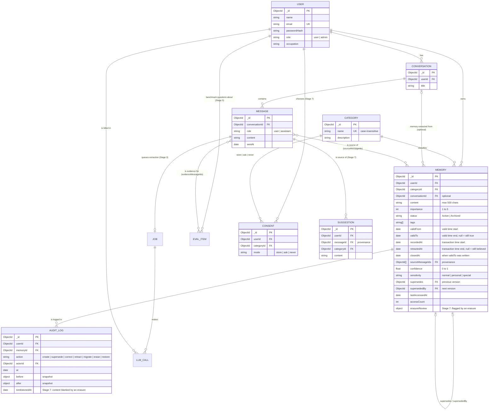

# AI Memory Organizer

A backend that stores what an AI assistant learns about a user ("memories"), organised by category,
linked back to the conversation they came from, and protected by per-user login.
Built with **Node.js, Express and MongoDB (Mongoose)**.

It started as a DBMS course project (CRUD, indexing, aggregation) and is being developed in stages
towards a research project on AI memory as a database problem. See [`docs/ROADMAP.md`](docs/ROADMAP.md).
This README describes the code as of **Stage 2: bi-temporal memory schema**.

## What it does

- **Accounts and login.** Register and log in; passwords are stored as bcrypt hashes; login returns a JWT.
- **Per-user data.** Every memory and conversation query is scoped to the logged-in user. Nobody can read or change another user's data.
- **Memories** with a category, importance (1 to 5), Active/Archived status, tags, and an optional link to the conversation they were extracted from.
- **Conversations and messages**, with messages in their own collection so a long chat never outgrows a document.
- **Referential integrity** enforced in a service layer, because MongoDB has no foreign keys.
- **Cursor pagination** on every list endpoint.
- **Aggregations**: memories per category (`$group` + `$lookup`) and the Active/Archived ratio (`$group` + `$cond`).
- **Indexes** designed with the ESR rule and checked with `explain()`.
- **Bi-temporal memories** (Stage 2). A memory is a chain of versions. Each version records when the fact was
  true (*valid time*) and when the database believed it (*transaction time*). Updates never overwrite: they
  supersede the old version inside a transaction. You can ask what was true at any date (`?asOf=`) and what the
  database believed at any moment (`?knownAt=`). See [Bi-temporal memories](#bi-temporal-memories).
- **Provenance and an audit log.** Each memory can cite the messages it came from (`sourceMessageIds`). Every
  create, supersede, correction and delete is written to an append-only `auditlog` collection.
- **Automatic memory extraction with an LLM** (Stage 3). Posting a message queues a job; a worker asks the LLM
  for durable facts about the user, compares each one with similar existing memories and decides ADD, UPDATE,
  SUPERSEDE or NOOP, then writes it through the bi-temporal service. A deterministic mock LLM is the default, so
  nothing costs money until you switch to Claude. See [LLM extraction pipeline](#llm-extraction-pipeline).
- **Hybrid retrieval and question answering** (Stage 4). Every memory version stores an embedding. A question is
  answered from the top-k memories ranked by keyword score + vector similarity + recency + importance, using only
  facts that were valid at the question's date (`asOf`), and the answer cites the memories it used
  (`POST /api/ask`). See [Hybrid retrieval and /api/ask](#hybrid-retrieval-and-apiask-stage-4).

## Quick start

You need **Node.js 20+** and **MongoDB 7 running as a replica set** (a single node is enough). Changes to memories
run in transactions, and MongoDB only has transactions on a replica set. Atlas clusters already are one.

```bash
# 1. MongoDB as a single-node replica set, if you do not have one running (Docker):
docker run -d --name mongo -p 27017:27017 mongo:7 --replSet rs0
docker exec mongo mongosh --quiet --eval "rs.initiate({_id: 'rs0', members: [{_id: 0, host: 'localhost:27017'}]})"

# 2. Install and configure
npm install
cp .env.example .env        # then set JWT_SECRET to a long random value

# 3. Load sample data (3 users, 4 categories, 5 conversations, 19 messages, 61 memory versions of which 58 are current)
npm run seed

# 4. Start the API on http://localhost:5000
npm start
```

### Run MongoDB as a replica set

A replica set is a group of MongoDB servers that keep copies of the same data. One server on its own can still be
a replica set ("single-node"). That is all transactions need. It is a one-time setup:

- **Docker:** the two commands in the Quick start above.
- **MongoDB installed as a Windows service:** step-by-step PowerShell commands are in
  [`docs/stages/STAGE-2.md`](docs/stages/STAGE-2.md#6-demo-on-your-laptop). In short: add
  `replication:` / `  replSetName: rs0` to `mongod.cfg`, restart the `MongoDB` service, then run
  `mongosh --eval "rs.initiate()"` once.
- **Linux / macOS install:** add the same two lines to `/etc/mongod.conf` (or `/opt/homebrew/etc/mongod.conf`),
  restart `mongod`, then run `mongosh --eval "rs.initiate()"` once.

Check it with `mongosh --quiet --eval "rs.status().ok"` (prints `1`). The connection string does not change.
If MongoDB is not a replica set, `npm start` prints a warning, reads still work, writes to memories return `503`,
and `npm test` stops with a message pointing here.

### Sample users

`npm run seed` creates three users. **All of them use the password `DevPassword123`**
(change it with `SEED_PASSWORD`). This is for local development only; never run the seed against a database
with real data, because it deletes everything first.

| Email | Role |
|---|---|
| `aarav.mehta@example.com` | **admin** (can create, rename and delete categories) |
| `priya.nair@example.com` | user |
| `daniel.fernandes@example.com` | user |

### Environment variables

| Variable | Default | Meaning |
|---|---|---|
| `MONGO_URI` | `mongodb://127.0.0.1:27017/aimemory` | Database for the app, the seed and the scripts |
| `MONGO_URI_TEST` | `mongodb://127.0.0.1:27017/aimemory_test` | Database for `npm test`. **The tests drop it**, so never point it at real data |
| `PORT` | `5000` | HTTP port |
| `JWT_SECRET` | insecure dev value | Signs login tokens. **Required when `NODE_ENV=production`** |
| `JWT_EXPIRES_IN` | `7d` | Token lifetime |
| `BCRYPT_ROUNDS` | `10` | bcrypt cost factor |
| `SEED_PASSWORD` | `DevPassword123` | Password of the seeded users |
| `MIGRATE_DEFAULT_PASSWORD` | unset | Used by `npm run migrate` for old users without a password |
| `LLM_PROVIDER` | `mock` | `mock` (deterministic, free, used by every test) or `anthropic` (Claude, costs money) |
| `ANTHROPIC_API_KEY` | unset | Needed for `LLM_PROVIDER=anthropic` and `npm run test:live`. Put it in `.env`, never in code |
| `EXTRACTION_MODEL`, `RECONCILE_MODEL`, `JUDGE_MODEL` | `claude-opus-5-5` | Model per task (the judge is for Stage 6) |
| `LLM_EFFORT` | `medium` | Thinking depth: `low`, `medium`, `high`, `xhigh`, `max` |
| `LLM_FALLBACKS` | `default` | `default`: a refused request is retried server-side on a fallback model; `off`: no fallback |
| `EXTRACTION_ENABLED` | `true` | `false` stops queuing extraction jobs |
| `EXTRACTION_CONTEXT_MESSAGES` | `6` | Earlier messages sent with the new one as context |
| `WORKER_IN_PROCESS` | `false` | `true` runs the worker inside `npm start` (one-window demo) |
| `WORKER_POLL_MS`, `JOB_RETRY_DELAY_MS`, `JOB_LOCK_TIMEOUT_MS` | `2000`, `5000`, `300000` | Worker poll interval, first retry delay (doubles each attempt), and how long before a dead worker's job is taken back |
| `MONGO_URI_LIVE` | `mongodb://127.0.0.1:27017/aimemory_live` | Database for `npm run test:live`. **It is dropped** |
| `EMBEDDING_PROVIDER` | `lexical` | `lexical` (offline hashed words + trigrams: a **lexical baseline, not a semantic model**), `mock` (test double, used by `npm test`) or `voyage` (semantic, paid) |
| `VOYAGE_API_KEY`, `VOYAGE_MODEL`, `VOYAGE_DIMENSIONS` | unset, `voyage-3.5`, `1024` | Voyage AI embeddings (only with `EMBEDDING_PROVIDER=voyage`) |
| `VECTOR_BACKEND` | `local` | `local`: brute-force cosine over the user's memories (any MongoDB). `atlas`: `$vectorSearch` (Atlas only) |
| `ATLAS_VECTOR_INDEX` | `memory_vector_index` | Name of the Atlas vector index |
| `RETRIEVAL_W_TEXT`, `RETRIEVAL_W_VECTOR`, `RETRIEVAL_W_RECENCY`, `RETRIEVAL_W_IMPORTANCE` | `0.4`, `0.4`, `0.1`, `0.1` | Weights of the hybrid score |
| `RETRIEVAL_TOP_K`, `RETRIEVAL_CANDIDATES` | `5`, `50` | Memories sent to the answer model (max 20); size of each candidate list |
| `RETRIEVAL_MIN_VECTOR` | the embedder's (lexical `0.3`) | Minimum cosine for a memory with no keyword match |
| `RETRIEVAL_HALF_LIFE_DAYS` | `90` | Recency halves every N days |
| `ANSWER_MODEL` | `claude-opus-5-5` | Model that answers `POST /api/ask` (with `LLM_PROVIDER=anthropic`) |
| `MONGO_URI_BENCH` | `mongodb://127.0.0.1:27017/aimemory_bench` | Database for `npm run bench:retrieval` and `npm run bench:indexes`. **It is dropped**; its name must contain `bench` |
| `MONGO_URI_EVAL` | `mongodb://127.0.0.1:27017/aimemory_eval` | Database for `npm run eval` (Stage 6). **It is dropped** before each sample; its name must contain `eval` |
| `DATA_DIR` | `./data` | Where `npm run data:download` saves datasets (gitignored) |
| `HF_TOKEN` | unset | Hugging Face read token, for gated datasets. Sent only to `huggingface.co` |
| `RETENTION_SPECIAL_DAYS` | unset (off) | Stage 7: `npm run retention` erases `special`-sensitivity memory versions recorded more than this many days ago. Unset or `0` = no expiry |

### npm scripts

| Command | What it does |
|---|---|
| `npm start` | Start the API |
| `npm run dev` | Start with automatic restart on file changes |
| `npm run seed` | Empty the database and load the sample data |
| `npm test` | Run the test suite (needs MongoDB, see [Tests](#tests)) |
| `npm run explain` | Print the indexes and the query plan of the main queries |
| `npm run worker` | Run the extraction worker (add `-- --drain` to process what is queued and exit) |
| `npm run llm:costs` | Tokens, prompt-cache hit rate and cost per model, task and prompt version, from `llmcalls` (`-- --include-mock` to include mock rows) |
| `npm run test:live` | Opt-in live smoke test with the real API (3 conversations). Prints a cost estimate first; skips if `ANTHROPIC_API_KEY` is not set. `-- --estimate` prints only the estimate |
| `npm run data:download` | Download datasets into `data/` and check their SHA-256 (`-- locomo` is the default; `-- --from <file>` uses a file you downloaded) |
| `npm run data:load:locomo` | Load LoCoMo as benchmark users, conversations, messages and `evalitems`. Skips loaded samples; `-- --reset` replaces them |
| `npm run data:synthetic` | Generate synthetic memories for scale tests: `-- --memories 100000 [--users N] [--seed 42] [--reset]`, or `-- --remove` |
| `npm run data:stats` | Count documents per dataset label and check the LoCoMo file; writes `results/stage5-dataset-stats.json` |
| `npm run embed:backfill` | Embed every memory version that has no vector from the current model (`-- --dataset synthetic`, `-- --batch 50`). Safe to re-run |
| `npm run atlas:index` | Create the Atlas vector index from `atlas/vector-index.json` (Atlas only); `-- --print` just prints it |
| `npm run bench:retrieval` | Retrieval latency p50/p95 at 1k and 10k **synthetic** memories; writes `results/stage4-retrieval-latency.csv` and `.txt` (`-- --sizes 1000,10000 --queries 200`) |
| `npm run bench:indexes` | Stage 6 DBMS experiment: the main queries with and without indexes at 10k / 100k / 1M **synthetic** memories (`explain("executionStats")` + wall-clock); writes `results/stage6-index-bench*.csv`, `.txt` and SVG charts (`-- --sizes 10000 --repeats 10 --out /tmp/x`) |
| `npm run eval` | Stage 6 evaluation on LoCoMo: six systems answer the same questions, scored by token F1 and an LLM judge; writes `results/<run-id>/`. Mock model by default; any paid provider needs `-- --paid` (see [Evaluation](#evaluation-stage-6)) |
| `npm run eval:cost` | Cost projection for the paid evaluation (no API calls); writes `results/stage6-cost-projection.csv` and `.txt` |
| `npm run eval:judge-agreement -- results/<run-id>` | After you label `judge_validation.csv`: agreement and Cohen's kappa between you and the LLM judge |
| `npm run erasure:verify` | Stage 7: proves nothing derived from erased data remains (anti-joins over every reference). `-- --user <id>`, `-- --messages <id>,<id>`, `-- --text "phrase"`. Exit code 1 if any check fails |
| `npm run retention` | Stage 7: erase `special` memories older than `RETENTION_SPECIAL_DAYS` (`-- --days 365` overrides, `-- --dry-run` only counts). Schedule it daily (cron or Windows Task Scheduler) |
| `npm run migrate` | Upgrade an older database to the current schema: runs the Stage 1 and Stage 2 migrations in order (see [Upgrading an old database](#upgrading-an-old-database)) |

## Using the API

Everything except `/api/auth/*` and `GET /` needs the header `Authorization: Bearer <token>`.

```bash
# Log in and keep the token
TOKEN=$(curl -s -X POST http://localhost:5000/api/auth/login \
  -H 'Content-Type: application/json' \
  -d '{"email":"priya.nair@example.com","password":"DevPassword123"}' | node -pe 'JSON.parse(require("fs").readFileSync(0)).token')

# Her Health memories, 2 per page
curl -s "http://localhost:5000/api/memories?category=health&limit=2" -H "Authorization: Bearer $TOKEN"
```

### Endpoints

| Method and path | Purpose |
|---|---|
| `POST /api/auth/register` | Create an account. Body: `{ name, email, password, occupation? }`. Returns `201 { user, token }` |
| `POST /api/auth/login` | Body: `{ email, password }`. Returns `{ user, token }` |
| `GET /api/users/me` | Your account (`me` or your own id; anyone else's id is `403`) |
| `PUT /api/users/me` | Update `name`, `email`, `occupation`, or `password` (changing it also needs `currentPassword`) |
| `DELETE /api/users/me` | Delete your account and, in one transaction, your conversations, messages, every memory version, your audit log entries, extraction jobs, LLM call log, consent settings and suggestions |
| `GET /api/categories`, `GET /api/categories/:id` | Read the shared categories (any user) |
| `POST /api/categories`, `PUT /api/categories/:id`, `DELETE /api/categories/:id` | Change categories (**admin only**). Delete is `409` while any memory version that is not retracted (current or past) uses the category |
| `GET /api/conversations` | Your conversations, newest first |
| `POST /api/conversations` | Body: `{ title }` |
| `GET /api/conversations/:id` | One conversation, with `messageCount` |
| `PUT /api/conversations/:id` | Body: `{ title }` |
| `DELETE /api/conversations/:id` | Delete it and its messages, and **erase everything derived from them** (Stage 7, see [Privacy and governance](#privacy-and-governance-stage-7)). The response has an `erasure` receipt (counts) |
| `GET /api/conversations/:id/messages` | Messages in chat order |
| `POST /api/conversations/:id/messages` | Body: `{ role: "user" \| "assistant", content }`. A `user` message also queues an extraction job (returned as `extractionJobId`); the response does not wait for it |
| `DELETE /api/conversations/:id/messages/:messageId` | Delete one message and erase every memory version derived only from it (Stage 7); returns the `erasure` receipt |
| `GET /api/jobs` | Your extraction jobs, newest first. Filter: `status` (`pending`, `running`, `done`, `failed`) |
| `GET /api/jobs/:id` | One job, with the decision taken for each candidate fact (`result.decisions`) |
| `POST /api/memories` | Body: `{ content, category` (name) `or categoryId, importance?, status?, tags?, conversationId?, validFrom?, confidence?, sensitivity?, sourceMessageIds? }`. Returns `201` with the first version |
| `GET /api/memories` | Your **current** memories, newest first. Filters: `status`, `category`, `categoryId`, `minImportance`, `needsReview=true` (versions an erasure flagged). Time travel: `asOf` (valid time) and/or `knownAt` (transaction time), ISO dates |
| `GET /api/memories/:id` | One version (current or past; a retracted one is `404`). Counts as an access (`accessCount`, `lastAccessedAt`) |
| `GET /api/memories/:id/history` | The whole version chain, oldest first, from any of its versions |
| `PUT /api/memories/:id` | **Supersede**: creates a new version and closes this one; returns the new version. Any of `content`, `category`/`categoryId`, `importance`, `status`, `tags`, `conversationId` (`null` unlinks), `confidence`, `sensitivity`, `sourceMessageIds`, `validFrom` (when the change happened; default now). Send `"correction": true` to fix a mistake instead. Only the current version can be updated (`409` otherwise) |
| `DELETE /api/memories/:id` | **Retract** one version: it disappears from current results but stays in the history |
| `GET /api/audit` | Your audit log, newest first. Filter: `memoryId` |
| `GET /api/memories/stats/by-category` | Count, active count and average importance per category (current versions) |
| `GET /api/memories/stats/status-ratio` | Active vs Archived: counts, percentages, ratio (current versions) |
| `GET /api/memories/search?q=` | Keyword search over the content and tags of current versions, ranked by relevance. Takes `limit` but no `cursor` |
| `GET /api/memories/retrieve?q=&asOf=&k=` | Hybrid retrieval (Stage 4): the top `k` (default 5, max 20) memories valid at `asOf` (default now), each with its `score` and the four parts (`text`, `vector`, `recency`, `importance`). Counts as an access |
| `POST /api/ask` | Body: `{ question, asOf?, k? }`. Retrieves the top-k memories valid at `asOf` and answers with the LLM. Returns `{ answer, insufficient, citedMemoryIds, citations, memories }`. With no relevant memory it answers "I don't have any memories..." without calling the LLM. `502` if the model fails or cites a memory it was not shown |

| `GET /api/me/consent` | Stage 7: your consent mode (`store`, `ask`, `never`) for every category; `store` until you choose |
| `PUT /api/me/consent/:category` | Body: `{ mode, eraseExisting? }`. `:category` is a name or id. `never` also erases what is stored in the category unless `eraseExisting: false` |
| `GET /api/me/suggestions` | Facts the extractor found in `ask` categories, waiting for your decision (they are not memories) |
| `POST /api/me/suggestions/:id/accept`, `DELETE /api/me/suggestions/:id` | Accept (becomes a memory, `201`) or reject (deleted) |
| `GET /api/me/export` | Everything stored about you as one JSON file (`?embeddings=true` adds the vectors) |
| `GET /api/me/erasure-check?text=` | The erasure verification for your own data |

`GET /` returns this list as JSON.

### Pagination

List endpoints return `{ count, limit, nextCursor, <items> }` (the items are under `memories`,
`conversations`, `messages` or `categories`).

- `?limit=` is a whole number from 1 to 100 (default 20). Larger values are capped at 100, and the response
  shows the limit that was used. `0`, negative or non-numeric values are a `400`.
- `?cursor=` is the `nextCursor` of the previous page. `nextCursor` is `null` on the last page.
- The cursor is the `_id` of the last item (keyset pagination). Unlike `skip`/`limit`, a page does not shift if
  items are added or deleted between requests, and deep pages are as cheap as the first.
- Memories, conversations and categories are ordered by `_id` (newest first, except categories: oldest first).
  Messages are ordered by `sentAt` (chat order).
- Search is the one exception: results are ranked by relevance, which is not the `_id` order, so it returns the
  top `limit` matches without a cursor.

### Errors

Errors are `{ "error": "message" }`.

| Status | Meaning |
|---|---|
| `400` | Invalid input: validation failed, malformed id, unknown category or conversation, bad query parameter |
| `401` | Missing, invalid or expired token, or wrong email/password |
| `403` | Not allowed: another user's account, or a non-admin changing categories |
| `404` | Not found. Another user's memory or conversation is also `404`, so ids of other users' data cannot be probed |
| `409` | Conflict: duplicate email or category name, or deleting a category that is still in use |

## Bi-temporal memories

People change: they move city, change goals, and sometimes the assistant simply got a fact wrong. Overwriting a
memory loses what was believed before; deleting it loses that it was ever true. Since Stage 2 every memory is a
**chain of versions**, and every version carries two time intervals:

| Axis | Fields | Question it answers | Who sets it |
|---|---|---|---|
| **Valid time** | `validFrom`, `validTo` | When was the fact true in the user's life? | The client may backdate `validFrom` (never in the future). `validTo` is set when the fact is superseded |
| **Transaction time** | `recordedAt`, `retractedAt` | When did the database believe this version? | Always the server clock |

`validTo = null` means "still true"; `retractedAt = null` means "still believed". A **current** version has both
null. Intervals are half-open: a version is valid from `validFrom` up to, but not including, `validTo`.
`closedAt` records the transaction time at which `validTo` was written, so `knownAt` queries show `validTo` as it
was known then.

Three kinds of change, each one transaction that also writes the audit log:

| Request | What happens | Audit action |
|---|---|---|
| `PUT /api/memories/:id` | **Supersede**: the fact changed. The old version gets `validTo` = the new `validFrom` and `supersededBy`; a new version is inserted with `supersedes` | `supersede` |
| `PUT` with `"correction": true` | **Correction**: the old version was wrong all along. It is retracted (`retractedAt`); the new version takes over its valid time | `correct` |
| `DELETE /api/memories/:id` | **Retraction**: we no longer believe this version. Nothing is physically deleted (hard erasure comes in Stage 7) | `retract` |

### Worked example (seeded user Priya)

Priya lived in Kochi from June 2019. The assistant first recorded this on 10 Feb 2023. She moved to Bengaluru
on 1 Aug 2024, but the assistant only learned it on 20 Aug 2024. The seed stores two versions:

| Version | content | validFrom | validTo | recordedAt | retractedAt |
|---|---|---|---|---|---|
| v1 | User lives in Kochi with their parents. | 2019-06-01 | **2024-08-01** | 2023-02-10 | null |
| v2 | User moved from Kochi to Bengaluru ... | 2024-08-01 | null | 2024-08-20 | null |

| Query | Answer | Why |
|---|---|---|
| `GET /api/memories` | v2 (Bengaluru) | the current version |
| `?asOf=2023-06-01` | v1 (Kochi) | valid time: what was true then, as we know it today |
| `?asOf=2024-08-10` | v2 (Bengaluru) | she had already moved on 10 Aug |
| `?asOf=2024-08-10&knownAt=2024-08-15` | **v1 (Kochi)** | on 15 Aug we had not been told about the move yet |
| `?knownAt=2022-01-01` | nothing about her city | the database knew nothing before 10 Feb 2023 |
| `GET /api/memories/<v1 or v2>/history` | v1 then v2 | the version chain, followed with `$graphLookup` |

The two axes disagree exactly when the database learns about a change late (or a mistake is corrected), which is
why both are kept. The seed also has a changed goal (Daniel) and a corrected mistake (Aarav's placement month).

```bash
curl -s "http://localhost:5000/api/memories?asOf=2024-08-10&knownAt=2024-08-15&category=personal" -H "Authorization: Bearer $TOKEN"
```

## LLM extraction pipeline

Stage 3 turns chat messages into memories automatically. The API never waits for the LLM: posting a message saves
it and queues a job **in the same transaction** (the *transactional outbox* pattern), and a separate worker runs
the pipeline.

```mermaid
sequenceDiagram
  participant C as Client
  participant API as Express API
  participant DB as MongoDB
  participant W as Worker (npm run worker)
  participant X as LLM (mock or Claude)
  C->>API: POST /api/conversations/:id/messages
  API->>DB: insert message + "extract" job (one transaction)
  API-->>C: 201 Created (extractionJobId)
  W->>DB: claim the oldest pending job (atomic findOneAndUpdate)
  W->>DB: read the new message + the 6 messages before it
  W->>X: extract candidate facts (prompts/extract.v1.md)
  X-->>W: [{content, topic, category, importance, confidence, sensitivity, validFrom}]
  loop each candidate
    W->>DB: text search: similar CURRENT memories of this user
    W->>X: decide (prompts/reconcile.v1.md), skipped when nothing is similar
    X-->>W: ADD / UPDATE / SUPERSEDE / NOOP + reason
    W->>DB: write through memoryService (new version + audit entry, via "extractor")
  end
  W->>DB: job done, decisions stored on the job; every LLM call logged in llmcalls
```

| Decision | Meaning | What is written (Stage 2 terms) |
|---|---|---|
| `ADD` | A new fact | A new memory (first version), `sourceMessageIds` = the message |
| `UPDATE` | The same fact, more precise ("likes coffee" -> "likes black coffee") | A **correction**: new version, old one retracted, sources merged |
| `SUPERSEDE` | The world changed ("lives in Pune" -> "lives in Mumbai") | A **supersede**: old version's valid time ends where the new fact starts |
| `NOOP` | Already known | Nothing |

Facts in a category that does not exist are skipped, and every fact passes a consent check first
(`services/consentService.js`, which allows everything until Stage 7 adds the settings). A failed job is retried
with exponential back-off (3 attempts); a refusal or a bad request is not retried. `GET /api/jobs/:id` shows what
was decided and why.

### Switching providers

| Provider | How | Cost | Used by |
|---|---|---|---|
| Mock (default) | `LLM_PROVIDER=mock` | Free; token counts are estimates (`tokensEstimated: true`, cost 0) | All tests, CI, the demo |
| Claude | `LLM_PROVIDER=anthropic` and `ANTHROPIC_API_KEY` in `.env` | Real; logged per call in `llmcalls` | Your laptop, `npm run test:live` |

The Claude provider (`services/llm/anthropicProvider.js`, official `@anthropic-ai/sdk`) uses:
- **Structured outputs** (`output_config.format` with a JSON schema), and the answer is validated again before use.
- **Prompt caching.** Each prompt file has a stable `## System` part, sent first with `cache_control`, and a
  `## User` part with everything that changes per call. After the first call the system part is read from the
  cache; `llmcalls.cacheReadTokens` shows it.
- **Refusal handling.** `stop_reason` is checked before the content. With `LLM_FALLBACKS=default` the API first
  retries a refused request on a fallback model; a final refusal fails the job without retrying.
- **A short context.** Only the new message and the `EXTRACTION_CONTEXT_MESSAGES` messages before it are sent.

Prompts are versioned files in `prompts/`. To change one, add `extract.v2.md` and point `services/llm/prompts.js` at
it; every `llmcalls` row records the prompt id and a hash of its text.

```bash
# Try it (mock LLM, free): start the API with the worker inside it, then post a message
WORKER_IN_PROCESS=true npm start
# ...or run the worker in its own terminal
npm run worker
# Cost report from llmcalls
npm run llm:costs -- --include-mock
# With a real key: estimate first, then the live smoke test (3 conversations, results in results/)
npm run test:live -- --estimate
npm run test:live
```

## Hybrid retrieval and /api/ask (Stage 4)

`POST /api/ask {"question": "Where do I live?", "asOf": "2022-06-01"}` runs **retrieval-augmented generation**
over your own memories:

1. **Time filter first.** Only versions valid at `asOf` (default now) and not retracted are candidates: the same
   filter as `GET /api/memories?asOf=`. A superseded fact can never be used to answer a question about today.
2. **Keyword candidates** from the MongoDB text index (top 50).
3. **Vector candidates**: the question is embedded and compared with the stored embeddings by cosine similarity
   (top 50). `VECTOR_BACKEND=local` does this by brute force in Node; `VECTOR_BACKEND=atlas` uses Atlas
   `$vectorSearch`.
4. **Hybrid score** for every candidate: `0.4*text + 0.4*vector + 0.1*recency + 0.1*importance` (weights in
   `.env`), where text is normalised to [0, 1], recency halves every 90 days and importance 1..5 maps to 0..1.
   A candidate with no keyword match and a cosine below the embedder's cut-off (0.3 for `lexical`) is dropped.
5. **Top-k** (default 5) go to the answer model with short labels (`m1`, `m2`, ...). The answer cites labels,
   which the server checks and maps back to memory ids (`citedMemoryIds`).

`GET /api/memories/retrieve?q=...` shows step 4's ranking without calling the LLM. Reconciliation (Stage 3) now
finds similar memories with the same retrieval (text + vector only, no access counted).

**Embeddings.** Each memory version stores `embedding` (hidden from API responses) and `embeddingModel`. The
default embedder, `lexical`, hashes words and character trigrams into 256 numbers: it is offline and free but it
is a **lexical baseline, not a semantic model** ("flat" does not match "apartment"). For real semantic search set
`EMBEDDING_PROVIDER=voyage` and `VOYAGE_API_KEY` (costs money), then run `npm run embed:backfill` to re-embed
existing memories. The Voyage provider has not been run against the real API yet.

**Latency** of one `retrieve()` call (synthetic data, lexical embedder, local backend, all memories owned by one
user, 200 queries, one run on the 4-CPU cloud container; `results/stage4-retrieval-latency.csv` and `.txt`):

| Memories (one user) | Mode | p50 | p95 |
|---|---|---|---|
| 1,000 | current | 39.43 ms | 50.39 ms |
| 1,000 | asOf | 33.53 ms | 45.48 ms |
| 10,000 | current | 259.45 ms | 322.24 ms |
| 10,000 | asOf | 212.65 ms | 331.54 ms |

Most of the time is the brute-force vector scan, which grows linearly with the memories per user.

### Atlas vector search (optional, on your laptop)

The cloud session cannot reach Atlas, so this path is not run in tests or CI; its pipeline is checked against an
emulator (`tests/fixtures/atlasEmulator.js`).

1. Create a free **M0** cluster on [MongoDB Atlas](https://www.mongodb.com/atlas), a database user, and allow
   your IP under *Network Access*.
2. In `.env`: `MONGO_URI=mongodb+srv://<user>:<password>@<cluster>/aimemory` and `VECTOR_BACKEND=atlas`.
3. `npm run seed` (Atlas clusters are replica sets, so transactions work).
4. `npm run atlas:index` creates `memory_vector_index` from `atlas/vector-index.json`, with `numDimensions` set
   to your embedder's size (256 for `lexical`, 1024 for `voyage`). Wait until it shows **READY** in the Atlas UI
   (*Atlas Search* tab). Alternatively paste the `definition` from the JSON file into the UI's JSON editor.
5. `npm start` and call `POST /api/ask` as usual.

## Datasets (Stage 5)

Benchmark and synthetic data are loaded into the same collections as the app's own data, with two extra
fields so they can never be mixed up: `dataset` (`real`, `benchmark` or `synthetic`) and `source` (the
dataset's name and its original id). API-created data has no label. The benchmark's question-answer labels go to
a separate `evalitems` collection, which the app never reads. Details, licences and counts:
[docs/DATASETS.md](docs/DATASETS.md).

```bash
npm run data:download                       # LoCoMo -> data/locomo/locomo10.json (SHA-256 checked)
npm run data:load:locomo                    # 10 users, 272 conversations, 5,882 messages, 1,986 evalitems
npm run data:synthetic -- --memories 10000  # synthetic memories for index experiments only
npm run data:stats                          # counts per label -> results/stage5-dataset-stats.json
```

Every loaded LoCoMo user can log in with `SEED_PASSWORD`, e.g. `locomo-conv-26@benchmark.invalid`.
Run `npm run seed` first if you want the sample users too: **seeding empties the database**, datasets included.

## Data model



Health memories default to sensitivity `special` (special-category data in GDPR Art. 9; the legal mapping is
Stage 7). The audit log is append-only: the model refuses updates and single deletes. Deleting a whole account is
the one case where entries are removed, together with everything else about that person.

### Referential integrity (no foreign keys in MongoDB)

All checks are in `services/`, so they apply to every route.

| Rule | Behaviour |
|---|---|
| A memory needs an existing category | `400 Unknown category` on create and update |
| A memory's conversation must exist **and be yours** | `400 Unknown conversationId` on create and update |
| Every `sourceMessageIds` entry must be a message in **your** conversations | `400 Unknown sourceMessageIds` |
| A version can be superseded only once | `409`; the unique index on `supersedes` makes a forked chain impossible |
| A message needs one of **your** conversations | `404` otherwise |
| Delete a category that a believed (not retracted) version uses | `409`, nothing is deleted |
| Delete a conversation | Its messages are deleted. Its memory versions are kept, unlinked from it and from the deleted messages |
| Delete a user | Their memory versions, audit entries, jobs, LLM-call logs, benchmark questions (`evalitems`), messages, conversations and the user are deleted |

Since Stage 2 every multi-document change (create/supersede/retract plus its audit entry, and the cascades above)
runs in a **transaction**: either all of it is saved or none of it.

## Indexes

Designed with the **ESR rule** (index **E**quality fields first, then the **S**ort field, then **R**ange fields)
and verified with `npm run explain`. Every list is paginated newest-first on `_id`, so `_id` is the sort key.

| Collection | Index | Serves | ESR |
|---|---|---|---|
| memories | `{ userId, validTo, retractedAt, _id: -1 }` | Current memories; also the `$match` of both aggregations | E: userId, validTo = null, retractedAt = null, S: _id |
| memories | `{ userId, validTo, retractedAt, status, _id: -1 }` | Current Active / Archived list | E: userId, validTo, retractedAt, status, S: _id |
| memories | `{ userId, validTo, retractedAt, categoryId, _id: -1 }` | Current list by category | E: userId, validTo, retractedAt, categoryId, S: _id |
| memories | `{ userId, _id: -1, validFrom, recordedAt }` | `?asOf=` / `?knownAt=` time travel | E: userId, S: _id, R: validFrom, recordedAt |
| memories | `{ categoryId, retractedAt }` | "Does a believed version still use this category?" (crosses users, so no userId prefix) | E: categoryId, retractedAt = null |
| memories | `{ supersedes }` unique, partial | Guarantees a version has at most one successor | E: supersedes |
| memories | `{ userId, content: text, tags: text }` | Keyword search, kept inside one user's data | E: userId |
| auditlog | `{ userId, _id: -1 }` | Your audit log, newest first | E: userId, S: _id |
| auditlog | `{ userId, memoryId, _id: -1 }` | The log of one version | E: userId, memoryId, S: _id |
| jobs | `{ status, runAt }` | The worker claims the oldest due job | E: status, S + R: runAt |
| jobs | `{ status, lockedAt }` | Finding jobs whose worker died | E: status, R: lockedAt |
| jobs | `{ userId, _id: -1 }` | `GET /api/jobs` | E: userId, S: _id |
| jobs | `{ payload.conversationId }` | Deleting a conversation's jobs | E: payload.conversationId |
| llmcalls | `{ userId, _id: -1 }` | A user's LLM calls (and deleting them with the account) | E: userId, S: _id |
| llmcalls | `{ jobId }` | The calls made for one job | E: jobId |
| conversations | `{ userId, _id: -1 }` | A user's conversations | E: userId, S: _id |
| messages | `{ conversationId, sentAt }` | One conversation in chat order | E: conversationId, S: sentAt |
| users | `{ email }` unique | Login, duplicate check | E: email |
| categories | `{ name }` unique, case-insensitive | Duplicate check, lookup by name | E: name |
| memories | `{ userId, sourceMessageIds }` (multikey) | Stage 7 lineage: the versions derived from given messages (erasure) | E: userId, sourceMessageIds |
| memories | `{ recordedAt }` partial on `sensitivity: "special"` (`retention_special`) | Stage 7 retention: special versions recorded before the cutoff, all users | R: recordedAt |
| consents | `{ userId, categoryId }` unique | Stage 7: a user's mode for a category (checked for every candidate fact) | E: userId, categoryId |
| consents, suggestions | `{ categoryId }` | Deleting a category removes its settings and suggestions | E: categoryId |
| suggestions | `{ userId, _id: -1 }` | A user's pending suggestions | E: userId, S: _id |
| suggestions | `{ userId, messageId, content }` unique | Erasure by message; a retried job cannot suggest a fact twice | E: userId, messageId |

"Current" is written as the **equality** `validTo: null, retractedAt: null`, not as a range on dates, so it
can sit in the equality part of an index. The time-travel index puts its ranges *after* the sort key: the scan
stays in `_id` order (no in-memory `SORT`) and versions that started after the asked time are skipped on the index
keys alone, before any document is fetched (`npm run explain` shows fewer documents examined than keys).
The history endpoint follows the chain with `$graphLookup`; each hop is a lookup on `_id`.

Deliberately **not** indexed: `userId` alone (a prefix of the compound indexes above) and `status` alone
(only two values, so it filters almost nothing). `minImportance` is a range on a field that is not in an index; it is
applied while documents are fetched.

Each index makes writes a little slower and uses memory, so each one above exists for a query the API actually runs.

`npm run explain` prints the plan of each of those queries and exits with an error on a duplicate index or a
collection scan (`COLLSCAN`). Example (seeded data):

```
memories: ?asOf= (valid time)
  plan:     LIMIT -> FETCH -> IXSCAN(userId_1__id_-1_validFrom_1_recordedAt_1)
  returned: 1, keys examined: 23, docs examined: 2
```

The query planner picks whichever usable index answers fastest on the data at hand, so on a small seeded database
the current-state list may also be served by the time-travel index. Either way there is no `COLLSCAN` and no `SORT`.

On MongoDB 8 the simple lookups by one field (login by email, "is this category in use?") are reported as
`EXPRESS_IXSCAN` instead of `IXSCAN`. That is MongoDB's faster path for these queries and it still uses the index.

The messages query shows a `SORT` stage: the tie-break on `_id` (needed so messages with the same timestamp
paginate in a stable order) is not part of the index. It only sorts one conversation's messages, so it stays small.
Adding `_id` as a third key of that index would remove it.

## Upgrading an old database

If you have a database created by an earlier version (the DBMS review version or Stage 1), run once:

```bash
npm run migrate
```

It is safe to run more than once. It drops the old indexes (standalone `userId` and `status`, the old compound,
text and conversation indexes), builds the new ones, moves messages embedded in conversation documents into the
`messages` collection, and lists users who have no password yet. Those users cannot log in until they get one:
set `MIGRATE_DEFAULT_PASSWORD` to give all of them the same temporary password, and ask them to change it.

The Stage 2 part (`scripts/migrate-stage2.js`) turns every memory into a current first version:
`validFrom = recordedAt = createdAt` (or the time inside its `_id` when `createdAt` is missing), `validTo`,
`retractedAt` and the links null, `confidence` 1, sensitivity `special` for Health and `normal` otherwise. It
replaces the Stage 1 memory indexes with the Stage 2 ones and writes a `migrate` entry to the audit log for each
memory, in the same transaction. Values that are already there are never overwritten, and a second run converts
nothing. It needs the replica set.

Starting the app on an old database without migrating does not crash, but the old indexes stay (the old text
index even blocks the new search index; the server prints a warning telling you to run `npm run migrate`) and
old conversations show no messages.

## Tests

Tests use **Jest and supertest against a real MongoDB** (no mocks), so MongoDB must be running **as a replica set**
(see [Run MongoDB as a replica set](#run-mongodb-as-a-replica-set)).

```bash
# if not already running
docker run -d --name mongo -p 27017:27017 mongo:7 --replSet rs0
docker exec mongo mongosh --quiet --eval "rs.initiate({_id: 'rs0', members: [{_id: 0, host: 'localhost:27017'}]})"
npm test
```

`npm test` runs the files one after another (`--runInBand`) because they share one database
(`MONGO_URI_TEST`, default `aimemory_test`), which is **dropped and recreated**. They cover CRUD, validation errors,
referential integrity, login and token handling, user isolation (user A cannot see or change user B's data),
pagination, both aggregations (including the orphan-category fix), text search, index design with `explain()`,
both migrations, Stage 4 embeddings, hybrid ranking, `asOf` filtering, local/Atlas parity and `/api/ask`
(`tests/embeddings.test.js`, `tests/retrieval.test.js`, `tests/ask.test.js`), and (Stage 2, `tests/temporal.test.js`) supersede, correction, retraction, history, `asOf` vs
`knownAt`, the audit log, concurrent updates, and transaction rollback when a step fails half-way.

GitHub Actions runs the same tests on every push and pull request (Node 20 and 22 on MongoDB 7, and Node 22 on
MongoDB 8) against MongoDB started in Docker as a single-node replica set, then seeds a database, runs
`npm run migrate` (which must be a no-op) and `npm run explain` as a smoke test (`.github/workflows/ci.yml`).

## Project structure

```
app.js              Express app (middleware, routes, error handler); imported by tests
index.js            Connects to MongoDB and starts the server
models/             Mongoose schemas and indexes
services/           Business logic: integrity checks, scoping, cascades, aggregations, pagination, auth
routes/             Thin HTTP layer over the services
middleware/         JWT authentication, admin check, async error forwarding
services/llm/       LLM providers (Anthropic, mock), versioned prompt loader, schemas, pricing, call logging
services/embeddings/ Stage 4: embedding providers (mock, lexical, voyage), backfill
services/retrieval/  Stage 4: hybrid ranking, local and Atlas vector backends, retrieval settings
services/askService.js  Stage 4: POST /api/ask (retrieve top-k, answer, check citations)
atlas/              Atlas vector index definition (vector-index.json)
services/datasets/  Stage 5: LoCoMo loader, synthetic scale generator, shared reset and seeded random helpers
services/erasureService.js, erasureVerifier.js, consentService.js, suggestionService.js, exportService.js,
retentionService.js Stage 7: lineage erasure, its verification, consent, suggestions, export, retention
prompts/            Versioned LLM prompts (extract.v1.md, reconcile.v1.md, answer.v1.md; Stage 6: eval-answer.v1.md, judge.v1.md)
eval/               Stage 6: evaluation harness (run.js, harness.js, systems.js, metrics.js, report.js, stats.js),
                    index benchmark (bench-indexes.js), cost projection, judge agreement, SVG charts from CSVs
scripts/            explain.js (query plans), migrate.js (runs migrate-stage1.js, then migrate-stage2.js),
                    worker.js (extraction worker), live-smoke.js (npm run test:live), llm-costs.js,
                    embed-backfill.js, atlas-index.js, bench-retrieval.js (Stage 4),
                    verify-erasure.js, retention.js (Stage 7)
scripts/datasets/   download.js, load-locomo.js, generate-synthetic.js, stats.js (the npm run data:* commands)
data/               Downloaded datasets (gitignored, never committed)
results/            Outputs of committed scripts, each with its command, commit, date and dataset
seed.js             Sample data
tests/              Jest + supertest tests
docs/               Roadmap, prompt playbook, per-stage notes (docs/stages/STAGE-N.md), PRIVACY.md (Stage 7)
```

## Evaluation (Stage 6)

The harness in `eval/` compares six systems on LoCoMo questions: the whole conversation (`full_context`), plain RAG
over raw messages, an overwrite-style memory (no history), ours (bi-temporal memories with provenance), and two
ablations of ours (without the temporal fields, without provenance). All use the same answer prompt
(`prompts/eval-answer.v1.md`) and model; only the context differs. Answers are scored with LoCoMo-style token F1
and an LLM judge (`prompts/judge.v1.md`), with bootstrap 95% confidence intervals. Results, method and
limitations: [docs/RESULTS.md](docs/RESULTS.md).

```bash
npm run bench:indexes                         # index benchmark, 10k/100k/1M synthetic memories (~6 min here)
LLM_PROVIDER=mock npm run eval -- --questions 10   # pipeline check on the mock: NOT a result
npm run eval:cost                             # projected cost of the paid run (no API calls)
# Paid (only after checking the projection): pilot first, then the full run
LLM_PROVIDER=anthropic npm run eval -- --questions 10 --paid --run-id stage6-pilot
LLM_PROVIDER=anthropic npm run eval -- --samples all --questions 0 --paid --run-id stage6-locomo-full
```

## Privacy and governance (Stage 7)

Legal mapping (DPDP Act 2023 and GDPR) and its open `TODO: verify` items: [docs/PRIVACY.md](docs/PRIVACY.md).

- **Consent per category** (`/api/me/consent`): `store` (default), `ask` (the extractor keeps facts as
  suggestions you accept or reject) or `never` (the extractor drops them and the API refuses them with `409`).
  Setting `never` erases what is already stored in that category unless you send `eraseExisting: false`.
- **Lineage-based erasure.** Every memory version lists the messages it came from (`sourceMessageIds`). Deleting a
  message or a conversation, in one transaction:
  - hard-deletes every version derived **only** from the deleted messages (its embedding is in the same document);
  - keeps a version that also has other sources, removes the deleted ids from it and flags it
    (`erasureReview`, listed by `GET /api/memories?needsReview=true`), because its text may still hold something
    from the erased message;
  - repairs the version chain: the surviving versions are linked to each other, and if the erased version was the
    current one, the version it closed becomes current again (as if the message had never been said);
  - tombstones the audit log: entries about erased versions keep the action and time but no content, and an
    `erase` entry is added;
  - deletes the suggestions and extraction jobs of those messages.
- **Verification.** `npm run erasure:verify` (or `GET /api/me/erasure-check`) checks with anti-joins that no
  memory, audit snapshot, suggestion, job or benchmark label points at a missing message or version, and
  optionally that given message ids or a phrase appear nowhere.
- **Export.** `GET /api/me/export` returns every row about you from every collection as one JSON file.
- **Retention.** `npm run retention` erases `special` memories older than `RETENTION_SPECIAL_DAYS`, through the same
  erasure code. It is a scheduled job, not a TTL index: a TTL index deletes documents outside any transaction, so it
  would leave broken version chains and the deleted text in the audit log.

```bash
# Delete one message and everything derived from it, then prove it
curl -s -X DELETE "http://localhost:5000/api/conversations/$CONV/messages/$MSG" -H "Authorization: Bearer $TOKEN"
npm run erasure:verify -- --messages $MSG --text "penicillin"
```

## Known limitations (up to Stage 7)

- **Login only.** There is no password reset, email verification, refresh token or rate limiting on login.
  Do not expose it to the internet as it is.
- **Categories are shared** by all users and only admins can change them. The first admin has to be set in the
  database (the seed makes Aarav one); nobody can become admin through the API.
- **A retracted memory is not erased.** `DELETE /api/memories/:id` only retracts (the history keeps it). Hard
  erasure is by lineage (deleting the source message or conversation), by withdrawing consent for the category,
  by retention, or by deleting the account. A memory created by hand without `sourceMessageIds` has no lineage,
  so deleting a conversation only unlinks it.
- **Erasure flags, it does not re-derive.** A memory with several sources keeps its text when one source is erased
  (it is flagged for review); re-running the extractor on the remaining sources is not implemented.
- **Default consent is `store`** for every category, including Health. GDPR Art. 9 expects explicit opt-in for
  special categories; see docs/PRIVACY.md.
- **The legal mapping in docs/PRIVACY.md is not legal advice** and has `TODO: verify` items for a person to check.
- **No future-dated facts.** `validFrom` cannot be in the future (for example "I move to Pune next month"); that
  keeps "current" a simple equality on `validTo = null`.
- **Every update creates a version**, even a status change, so storage grows with the number of edits.
- **Retrieval still matches words, not meaning, by default.** The offline `lexical` embedder is a lexical baseline
  ("nut allergy" will not find "allergic to peanuts"); real semantic search needs `EMBEDDING_PROVIDER=voyage`
  (paid, not run yet). The extractor uses the same retrieval to find similar memories, so with the lexical embedder
  it can still miss a related memory that shares no words with the new fact (and then ADD a near-duplicate).
- **The local vector backend is brute force**: it reads every memory of the user that matches the time filter, so
  its cost grows linearly (see `results/stage4-retrieval-latency.csv`). Atlas `$vectorSearch` is approximate
  (HNSW) and was not run here.
- **Vectors are stored as arrays of doubles**: about 2.4 KB per memory version for the 256-number lexical vector,
  most of each document's size (measured in the benchmark). Every version keeps its own vector.
- **The mock LLM is a test double, not a model.** It recognises a few sentence patterns ("I live in", "I moved to",
  "I am allergic to", ...). Only the real model's output (`LLM_PROVIDER=anthropic`) says anything about quality.
- **LoCoMo is a chat between two people**, not a person and an assistant. The loader stores the first speaker as
  `user` and the second as `assistant`; the extractor only mines `user` messages, so facts said by the second
  speaker are not extracted by the app. The Stage 6 harness mines both speakers by adding a mirror user with the
  roles swapped (see [docs/RESULTS.md](docs/RESULTS.md)).
- **No real evaluation result yet.** The Stage 6 harness has only run on the mock model (a pipeline check). The paid
  LoCoMo run needs your approval; its projected cost is in `results/stage6-cost-projection.txt`.
- **Only LoCoMo is loaded.** LongMemEval and WildChat are on Hugging Face, which is blocked in the cloud session;
  there is no loader for them yet, and no PII scrubbing or annotation tool (see docs/DATASETS.md).
- **One worker, one job at a time.** Two workers would be safe (claiming is atomic) but could reconcile two facts of
  the same user against each other at the same moment.
