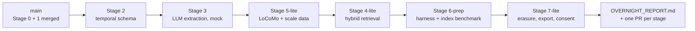
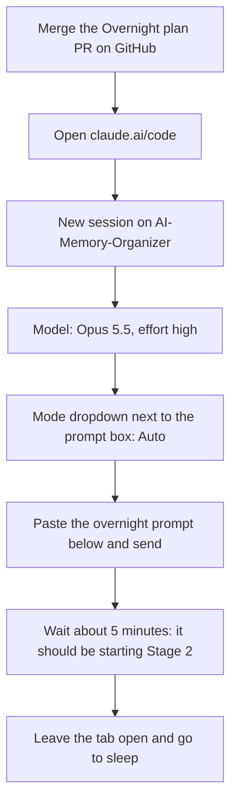
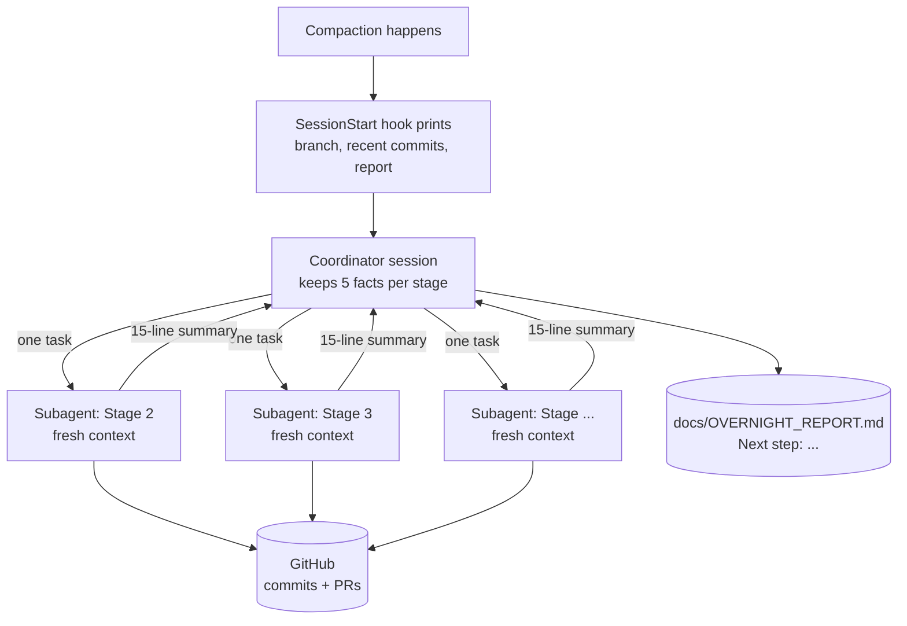

# Overnight Plan

One unattended Claude Code session builds the remaining stages while you sleep. You review, understand
and merge them over the following days.

## What runs tonight

| Order | Stage | Branch | Done tonight | Left for you |
|---|---|---|---|---|
| 1 | 2: Bi-temporal schema | `claude/stage-2-temporal-schema` | Everything | Switch laptop MongoDB to a replica set |
| 2 | 3: LLM extraction | `claude/stage-3-llm-extraction` | Everything, using a **mock** LLM, plus a free Ollama provider | Run the smoke test locally with Ollama |
| 3 | 5-lite: Real datasets | `claude/stage-5-datasets` | LoCoMo download + loader, synthetic scale generator | LongMemEval / WildChat (Hugging Face is blocked) |
| 4 | 4-lite: Hybrid retrieval | `claude/stage-4-hybrid-retrieval` | Local vector search + offline lexical embedder, mock in tests | Real embeddings via Ollama (free) |
| 5 | 6-prep: Evaluation | `claude/stage-6-evaluation` | Harness built and checked on the mock; **the full index benchmark actually runs** (no API cost) | Run the real evaluation free on your laptop with Ollama |
| 6 | 7-lite: Privacy | `claude/stage-7-governance` | Erasure by lineage, export, consent, DPDP/GDPR mapping | Have someone check the legal mapping |

**Nothing tonight costs API money.** Every LLM call goes through the mock, even if a key is set.
Real AI runs happen later on your laptop with Ollama, which is free and works offline.



Each stage is its own branch, stacked on the one before, with its own pull request into `main`. Merge them
**in the order above**. After each merge, the next PR's diff shrinks to just its own changes.

### Model and effort
**Claude Opus 5.5, effort `high`, permission mode `Auto`.**
- Opus 5.5 at high effort is strong enough for the schema, extraction and evaluation design, and doesn't burn
  your plan's usage as fast as Fable 5.1 or `xhigh`, which matters for an 8-hour run.
- If Opus 5.5 isn't offered, use Sonnet 5.5 at high effort.
- **Auto** mode is needed so the session doesn't stop and wait for you to approve commands.

---

## Before you sleep (about 10 minutes)



1. **Merge the "Overnight plan" pull request** on GitHub. It contains this file, the stage-notes rule in
   `CLAUDE.md` and `.claude/settings.json`, so all three must be on `main` first.
2. Open **claude.ai/code** and start a **new** session on `AI-Memory-Organizer`.
3. Pick **Opus 5.5**, effort **high**, and choose **Auto** in the mode dropdown next to the prompt box.
   If Auto isn't offered, pick Accept edits. `.claude/settings.json` pre-approves the routine commands, but the
   session may still stop on an unusual one.
4. Paste the prompt below and send it. Watch for about 5 minutes and check that it starts Stage 2 without asking
   you anything.
5. Optional: if you already have an `ANTHROPIC_API_KEY` in the environment settings, it's fine. The prompt
   forbids using it tonight.

## The overnight prompt

The session acts as a **coordinator**. It hands each stage to a fresh **subagent** and keeps only that
subagent's short summary, so its own context stays small all night (see
[Context window](#context-window-how-this-run-stays-inside-it)).

```text
Read CLAUDE.md, docs/ROADMAP.md and docs/OVERNIGHT_PLAN.md first, and follow them.

You are the COORDINATOR of an unattended overnight run. Nobody will answer questions until morning, so never
stop to ask. When something needs me, write it in docs/OVERNIGHT_REPORT.md and continue with work that doesn't
depend on it.

Do not build the stages yourself; that would fill your context window. For each row of the stage table in
docs/OVERNIGHT_PLAN.md ("Stage instructions for tonight"), in order:
  1. Launch ONE subagent with the Agent tool (general-purpose, in the foreground) and give it this task, filling
     in N, the branch and the base branch from the table:
     "Read CLAUDE.md (especially 'Context budget' and 'Stage notes'), docs/ROADMAP.md, docs/OVERNIGHT_PLAN.md
     and the Stage N prompt in docs/PROMPTS.md. Build Stage N on branch <branch>, created from <base>. Follow
     the Stage N row and the 'Rules for every stage' in docs/OVERNIGHT_PLAN.md, which override the Stage N
     prompt where they differ. You have explicit permission to create and push <branch>; never push to main.
     Reply with at most 15 lines: branch, PR URL, status (done / partial / blocked), number of tests passing,
     what was not done and why, and what the user must do."
  2. When it returns, check its claims cheaply:
     git ls-remote origin <branch>
     git log --oneline -3 origin/<branch>
  3. Update docs/OVERNIGHT_REPORT.md from its summary, setting the "Next step:" line to the next stage. Commit it
     on <branch> and push.
  4. Apply "If a stage fails" from docs/OVERNIGHT_PLAN.md, then move on to the next row.
Keep only these facts per stage in your own context: branch, PR URL, status, test count, blockers.

When you finish, or are about to run out of usage, make sure everything is pushed. End with a message
containing: a table of stages with status and PR links, then my morning checklist in order.
```

## Stage instructions for tonight

Each subagent reads its row here. **Nothing tonight costs money**: all LLM and embedding calls use the
deterministic mocks, even if a key is set. Live tests are built behind opt-in npm scripts but not run.

| N | Branch | Base branch | Overnight changes to the stage prompt in `PROMPTS.md` |
|---|---|---|---|
| 2 | `claude/stage-2-temporal-schema` | `origin/main` | Run MongoDB as a single-node replica set in Docker and in CI. In `STAGE-2.md`, give exact steps for converting a Windows MongoDB service into a replica set. |
| 3 | `claude/stage-3-llm-extraction` | stage 2 branch | Don't run the live smoke test. Leave `npm run test:live` ready with a cost estimate. Put stable prompt text first so prompt caching can be used, and log cache-read tokens in `llmcalls`. Send the extractor only the new message and a short recent window, not the whole conversation. **Add an `ollama` provider** (`LLM_PROVIDER=ollama`, `OLLAMA_URL` default `http://localhost:11434`, `OLLAMA_MODEL` default `qwen2.5-coder:14b`, `JUDGE_MODEL` default `deepseek-r1:14b`, with any `<think>...</think>` block stripped before parsing) using Ollama's HTTP API with JSON-format output; it is the free default for real runs. Tests use the mock only. |
| 5 | `claude/stage-5-datasets` | stage 3 branch | LoCoMo only (raw.githubusercontent.com works): download, load with `dataset: benchmark`, QA labels in `evalitems`. Add the synthetic scale generator (`dataset: synthetic`) and `docs/DATASETS.md`. Loaders for LongMemEval and WildChat are optional; mark them "not run: Hugging Face is blocked here" and never claim they were tested. Skip the annotation tool and PII scrubbing, and list them as not done. Inspect the data with capped scripts, never by printing it. |
| 4 | `claude/stage-4-hybrid-retrieval` | stage 5 branch | `VECTOR_BACKEND=local` (brute-force cosine) only. Embeddings: the mock, a deterministic offline lexical embedder (labelled as a lexical baseline, not a semantic model), an **`ollama` embeddings provider** (`OLLAMA_EMBED_MODEL` default `nomic-embed-text`, the free default for real runs), and a Voyage provider behind `VOYAGE_API_KEY`. None of the real providers are run tonight. For Atlas, commit the index JSON and the setup steps, but don't run them. Cap the memories sent to the answer model with top-k. |
| 6 | `claude/stage-6-evaluation` | stage 4 branch | See the Stage 6 details below. |
| 7 | `claude/stage-7-governance` | stage 6 branch | Consent per category, lineage-based erasure when a conversation or message is deleted, an erasure verification script, `GET /api/me/export`, and `docs/PRIVACY.md` (DPDP Act 2023 and GDPR, with `TODO: verify` on anything unsure). Skip retention if time is short. |

**Stage 6 details:**
- **Build** the evaluation harness: systems, metrics, the `results/` layout, and bootstrap confidence intervals.
- **Pipeline check:** run the harness end to end on a few LoCoMo items with the **mock** model only. Label that
  output "pipeline check (mock model), not a result".
- **Index benchmark, actually run:**
  - 10k, 100k and 1M synthetic memories, with and without indexes, measured with `explain("executionStats")`
    and wall-clock time.
  - Write `results/` CSVs recording the command, commit, date and dataset, plus charts.
  - If 1M takes more than 30 minutes, stop at 100k and say so.
- **Run plan** for the real LoCoMo evaluation on the student's laptop with Ollama (free; RTX 5070 Ti, 12 GB VRAM), with a
  projected run time. The Claude API is an optional, paid comparison; its cost projection is clearly labelled.

### Rules for every stage
- **Tests:** `npm test` passes against a real MongoDB in Docker, and CI is updated to match.
- **Pushing:** commit in logical steps and push after each one (the container can be reclaimed).
- **Pull request:** open one into `main` titled "Stage N: <name>". The body says which PR it is stacked on and that
  PRs must be merged in order.
- **Notes:** write `docs/stages/STAGE-N.md` following "Stage notes" in `CLAUDE.md`.
- **Context:** follow "Context budget" in `CLAUDE.md`. Short outputs, no data dumps, long jobs write to files.
- **Never:** skip or disable tests, force-push, rebase pushed branches, or invent results.

### If a stage fails
- If its tests still fail after a serious attempt, the subagent pushes its work to `<branch>-wip`. The
  coordinator marks the stage **partial** in the report.
- The next stage starts from the last green branch. Any stage that depends on the broken one is skipped
  (3 → 4 → 6; 5 → 6).
- If Stage 2 fails, stop after reporting, because everything depends on it.

## Context window: how this run stays inside it

A long agent run fails quietly when its context window fills up. Claude Code then **compacts**: it replaces older
conversation with a summary, and details can be lost. This plan avoids that in four layers:



| Layer | What it does | Where it's set |
|---|---|---|
| 1. A fresh context per stage | Each stage runs in its own subagent with a new context window. The coordinator only receives a 15-line summary, so even 6 stages use a small part of its window. | The overnight prompt |
| 2. Small outputs | Test output is tailed. Datasets are inspected with capped scripts. Benchmarks write to files and print a summary. Code is found with Grep before reading. | `CLAUDE.md` → "Context budget" |
| 3. State on disk | Progress lives in Git (pushed after every step) and in `docs/OVERNIGHT_REPORT.md` with a "Next step:" line, not only in the conversation. | `CLAUDE.md`, the overnight prompt |
| 4. Recovery after compaction | If compaction still happens, a hook prints the current branch, the last 5 commits and the end of the report, and the rules say to re-read them before continuing. | `.claude/settings.json` (SessionStart hook, matcher `compact`) |

### In your own (daytime) Claude Code sessions
- **`/context`** shows how full the context window is.
- **`/compact <what to keep>`** compacts early, on your terms. For example:
  `/compact keep the Stage 2 decisions and the failing test names`.
- **`/clear`** between unrelated tasks, such as after finishing one stage's review and before starting the next.
- **New session per stage.** Each prompt in `PROMPTS.md` already starts by reading `CLAUDE.md` and the roadmap, so
  a new session loses nothing.
- **Big files:** ask for a summary or for specific lines, not "show me the whole file".

### In the project's own AI runs (Stages 3, 4 and 6)
The same idea saves money when the app calls Claude:
- The extractor gets only the new message plus a short recent window, not the whole chat.
- `/api/ask` gets only the top-k retrieved memories.
- Stable prompt text comes first, so **prompt caching** can reuse it. The `llmcalls` collection logs cache hits.
- In the evaluation, the full-context baseline is the expensive system. Its cost is projected before anything runs.

---

## If something goes wrong overnight

| What you see in the morning | What it means | What to do |
|---|---|---|
| The session stopped part-way with a usage-limit message | Your plan's usage ran out | Open the same session and send: `Continue the overnight plan from where you stopped.` |
| A stage is marked **partial** and has a `-wip` branch | Its tests didn't pass in time | Use the **Resume** prompt in `docs/PROMPTS.md` for that stage |
| The session is waiting on a permission prompt | Auto mode wasn't on | Approve it, then switch the mode to Auto |
| No PRs at all | The session never really started | Check that the PR from step 1 was merged, then start again |
| The report says a stage was redone or skipped after "context compacted" | Compaction happened and the coordinator lost track | Check the stage's branch and PR; use the **Resume** prompt in `docs/PROMPTS.md` if it's incomplete |

Everything that was pushed is safe on GitHub, even if the cloud session itself is gone.

---

## In the morning

1. **Read the report.** It's the last message of the overnight session, and `docs/OVERNIGHT_REPORT.md` on the
   newest stage branch.
2. **Check the PRs.** You should see one PR per stage, each with green checks. A red ✗ means CI failed; open that
   PR in the overnight session and ask it to fix CI.
3. **Understand before merging.** For each stage, in order, read `docs/stages/STAGE-N.md`. Then ask Claude Code to
   quiz you on it (Sonnet 5.5, medium):
   `Quiz me on docs/stages/STAGE-N.md: ask the 10 examiner questions one at a time and correct my answers.`
   Merge the PR when you can answer them. You don't have to do all stages in one morning: Stage 2 and 3 matter
   most, so start there.
4. **Laptop setup.**
   - Convert your MongoDB service to a replica set using the steps in `docs/stages/STAGE-2.md`.
   - Then run `git checkout main`, `git pull`, `npm install` and `npm test`.
5. **Run the real AI parts for free, on your laptop with Ollama.** See below.

### Free local AI with Ollama (do the downloads in the daytime)
Ollama runs open models on your own GPU, with no API key and no bill. Downloads are big (about 6 GB in total), so
do them while your internet is good. After that, everything works offline.

```powershell
ollama list                      # should show qwen2.5-coder:14b and deepseek-r1:14b
ollama pull nomic-embed-text     # embedding model, about 0.3 GB
```

Then in your project `.env`:
```
LLM_PROVIDER=ollama
OLLAMA_MODEL=qwen2.5-coder:14b
JUDGE_MODEL=deepseek-r1:14b
OLLAMA_EMBED_MODEL=nomic-embed-text
```
`qwen2.5-coder:14b` does extraction, reconciliation and answers (it is good at clean JSON). `deepseek-r1:14b` is
the evaluation judge: it is slower, but reasons carefully, and using a different model as judge is good practice.
Full laptop setup: [`LOCAL_SETUP.md`](LOCAL_SETUP.md).

### Morning prompt (run in Claude Code on your laptop, not in the cloud)
The cloud session can't reach Ollama on your laptop, so this step runs locally. Use Sonnet 5.5 at high effort.

```text
Read CLAUDE.md, docs/OVERNIGHT_PLAN.md and docs/OVERNIGHT_REPORT.md. I'm on Windows (PowerShell) with Ollama
running locally (qwen2.5-coder:14b, deepseek-r1:14b and nomic-embed-text pulled) and LLM_PROVIDER=ollama in .env.

1. Check out the newest stage branch, then run npm install and npm test.
2. Stage 3: run the live extraction smoke test with the ollama provider. Show what it extracted and how long it took.
3. Stage 6: run the 10-item LoCoMo pilot with ollama for every system in the harness. Report the time taken and
   the projected time for the full run, then STOP and wait for my go-ahead.
Do not use any paid API. Save outputs to results/ with command, commit, date, dataset and model name,
commit them on the stage 6 branch, and update docs/stages/STAGE-6.md.
```

After you approve, the full run can go overnight on your laptop: plug it in and keep it awake. It doesn't need
internet. Then use the Stage 9 prompt in `docs/PROMPTS.md` for the write-up.

## How this helps you answer questions

Every stage writes `docs/stages/STAGE-N.md` with the same sections (see "Stage notes" in `CLAUDE.md`):
1. **In one paragraph:** what the stage does, in plain words.
2. **What changed:** every file and why.
3. **Concepts:** the textbook name for each idea (for example "bi-temporal data", "provenance",
   "keyset pagination", "ESR rule").
4. **Examiner questions:** 10 likely questions with short model answers.
5. **Weak points:** honest answers you can give if they come up.
6. **Demo on your laptop:** exact PowerShell commands.

Together with each PR's description, these give you a written record of every change, why it was made, and how
to defend it.
