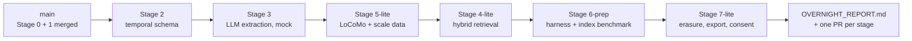
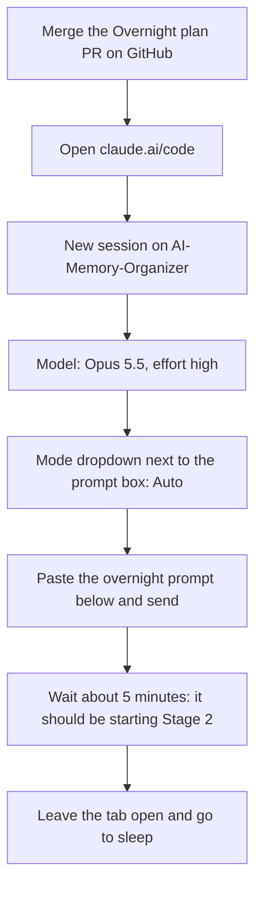

# Overnight Plan

One unattended Claude Code session builds the remaining stages while you sleep. You review, understand
and merge them over the following days.

## What runs tonight

| Order | Stage | Branch | Done tonight | Left for you |
|---|---|---|---|---|
| 1 | 2: Bi-temporal schema | `claude/stage-2-temporal-schema` | Everything | Switch laptop MongoDB to a replica set |
| 2 | 3: LLM extraction | `claude/stage-3-llm-extraction` | Everything, using a **mock** LLM | Run the live smoke test with your API key |
| 3 | 5-lite: Real datasets | `claude/stage-5-datasets` | LoCoMo download + loader, synthetic scale generator | LongMemEval / WildChat (Hugging Face is blocked) |
| 4 | 4-lite: Hybrid retrieval | `claude/stage-4-hybrid-retrieval` | Local vector search + offline lexical embedder, mock in tests | Real embeddings (Voyage key or Atlas), if you want them |
| 5 | 6-prep: Evaluation | `claude/stage-6-evaluation` | Harness built and checked on the mock; **the full index benchmark actually runs** (no API cost) | Approve and run the paid LLM evaluation |
| 6 | 7-lite: Privacy | `claude/stage-7-governance` | Erasure by lineage, export, consent, DPDP/GDPR mapping | Have someone check the legal mapping |

**Nothing tonight costs API money.** Every LLM call goes through the mock, even if a key is set.
Paid runs happen in the morning, after you've seen the projected cost.



Each stage is its own branch, stacked on the one before, with its own pull request into `main`. Merge them
**in the order above**. After each merge, the next PR's diff shrinks to just its own changes.

### Model and effort
**Claude Opus 5.5, effort `high`, permission mode `Auto`.**
- Opus 5.5 at high effort is strong enough for the schema, extraction and evaluation design, and doesn't burn
  your plan's usage as fast as Fable 5.1 or `xhigh`, which matters for an 8-hour run.
- If Opus 5.5 isn't offered, use Sonnet 5.5 at high effort.
- **Auto** mode is needed so the session doesn't stop and wait for you to approve commands.

---

## Before you sleep (about 10 minutes)



1. **Merge the "Overnight plan" pull request** on GitHub. It contains this file, the stage-notes rule in
   `CLAUDE.md` and `.claude/settings.json`, so all three must be on `main` first.
2. Open **claude.ai/code** and start a **new** session on `AI-Memory-Organizer`.
3. Pick **Opus 5.5**, effort **high**, and choose **Auto** in the mode dropdown next to the prompt box.
   If Auto isn't offered, pick Accept edits. `.claude/settings.json` pre-approves the routine commands, but the
   session may still stop on an unusual one.
4. Paste the prompt below and send it. Watch for about 5 minutes and check that it starts Stage 2 without asking
   you anything.
5. Optional: if you already have an `ANTHROPIC_API_KEY` in the environment settings, it's fine. The prompt
   forbids using it tonight.

## The overnight prompt

```text
Read CLAUDE.md, docs/ROADMAP.md, docs/PROMPTS.md and docs/OVERNIGHT_PLAN.md first, and follow them.

You are running UNATTENDED overnight. Nobody will answer questions until morning, so never stop to ask.
When something needs me, write it in docs/OVERNIGHT_REPORT.md and continue with work that doesn't depend on it.

Build these stages in this order. Each stage gets its own branch, created from the previous stage's branch
(Stage 2 from origin/main), and follows its prompt in docs/PROMPTS.md with the overnight changes below:
  1. Stage 2      -> claude/stage-2-temporal-schema
  2. Stage 3      -> claude/stage-3-llm-extraction
  3. Stage 5-lite -> claude/stage-5-datasets
  4. Stage 4-lite -> claude/stage-4-hybrid-retrieval
  5. Stage 6-prep -> claude/stage-6-evaluation
  6. Stage 7-lite -> claude/stage-7-governance
You have my explicit permission to create and push all of these branches. Never push to main.

Overnight changes:
- NO PAID API CALLS, even if ANTHROPIC_API_KEY or any other key is set. All LLM and embedding calls use the
  deterministic mocks. Build live tests behind opt-in npm scripts, but don't run them.
- Stage 2: set up MongoDB as a single-node replica set in Docker and in CI. In docs/stages/STAGE-2.md, include
  exact steps for converting my local Windows MongoDB service into a replica set.
- Stage 3: build everything in its prompt, but don't run the live smoke test. Leave `npm run test:live` ready
  and give an estimated cost for it.
- Stage 5-lite: only LoCoMo (raw.githubusercontent.com works). Download it, load it with dataset: benchmark,
  and store the QA labels in evalitems. Add the synthetic scale generator (dataset: synthetic) and
  docs/DATASETS.md. You may write loaders for LongMemEval and WildChat, but mark them "not run: Hugging Face is
  blocked here" and never claim they were tested. Skip the annotation tool and PII scrubbing; list them as
  not done.
- Stage 4-lite: VECTOR_BACKEND=local (brute-force cosine) only. For embeddings, provide the mock, plus a
  deterministic offline lexical embedder (clearly labelled as a lexical baseline, not a semantic model), plus a
  Voyage provider behind VOYAGE_API_KEY that is not run. For Atlas, commit the index JSON and the setup steps,
  but don't run them.
- Stage 6-prep: build the evaluation harness (systems, metrics, results/ layout, bootstrap CIs).
  - Run it end to end on a few LoCoMo items with the mock model only, as a pipeline check. Label that output
    "pipeline check (mock model), not a result".
  - Actually run the DBMS index benchmark: 10k, 100k and 1M synthetic memories, with and without indexes,
    using explain("executionStats") and wall-clock time. Write results/ CSVs with command, commit, date and
    dataset, plus charts. If 1M takes more than 30 minutes, stop at 100k and say so.
  - Write a cost projection for the real LoCoMo evaluation, clearly labelled as a projection.
- Stage 7-lite: consent per category, lineage-based erasure when a conversation or message is deleted, an
  erasure verification script, GET /api/me/export, and docs/PRIVACY.md (DPDP Act 2023 and GDPR, with
  "TODO: verify" on anything unsure). Skip retention if time is short.

For every stage:
- npm test passes against a real MongoDB in Docker, and CI is updated to match.
- Commit in logical steps and push after each one (the container can be reclaimed).
- Open a pull request into main titled "Stage N: <name>". Say in the body which PR it is stacked on and that PRs
  must be merged in order.
- Write docs/stages/STAGE-N.md following the "Stage notes" rule in CLAUDE.md.
- Append that stage's section to docs/OVERNIGHT_REPORT.md: status (done / partial / blocked), PR link, test
  count, what was not done and why, and what I must do.

If a stage fails:
- If its tests still fail after a serious attempt, push the work to a branch named <stage branch>-wip and
  describe it in the report.
- Start the next stage from the last green branch, and skip any stage that depends on the broken one.
- If Stage 2 fails, stop after reporting, because everything depends on it.
- Never skip or disable tests, never force-push, never rebase pushed branches, and never invent results.

When you finish, or are about to run out of usage, make sure everything is pushed. End with a message
containing: a table of stages with status and PR links, then my morning checklist in order.
```

---

## If something goes wrong overnight

| What you see in the morning | What it means | What to do |
|---|---|---|
| The session stopped part-way with a usage-limit message | Your plan's usage ran out | Open the same session and send: `Continue the overnight plan from where you stopped.` |
| A stage is marked **partial** and has a `-wip` branch | Its tests didn't pass in time | Use the **Resume** prompt in `docs/PROMPTS.md` for that stage |
| The session is waiting on a permission prompt | Auto mode wasn't on | Approve it, then switch the mode to Auto |
| No PRs at all | The session never really started | Check that the PR from step 1 was merged, then start again |

Everything that was pushed is safe on GitHub, even if the cloud session itself is gone.

---

## In the morning

1. **Read the report.** It's the last message of the overnight session, and `docs/OVERNIGHT_REPORT.md` on the
   newest stage branch.
2. **Check the PRs.** You should see one PR per stage, each with green checks. A red ✗ means CI failed; open that
   PR in the overnight session and ask it to fix CI.
3. **Understand before merging.** For each stage, in order, read `docs/stages/STAGE-N.md`. Then ask Claude Code to
   quiz you on it (Sonnet 5.5, medium):
   `Quiz me on docs/stages/STAGE-N.md: ask the 10 examiner questions one at a time and correct my answers.`
   Merge the PR when you can answer them. You don't have to do all stages in one morning: Stage 2 and 3 matter
   most, so start there.
4. **Laptop setup.**
   - Convert your MongoDB service to a replica set using the steps in `docs/stages/STAGE-2.md`.
   - Then run `git checkout main`, `git pull`, `npm install` and `npm test`.
5. **Run the paid parts.** Once you have an API key, start a new session (Opus 5.5, high effort, Auto) with the
   morning prompt below.

### Morning prompt (live checks, costs a little money)

```text
Read CLAUDE.md, docs/OVERNIGHT_PLAN.md and docs/OVERNIGHT_REPORT.md. ANTHROPIC_API_KEY is now set.

1. Stage 3: run `npm run test:live` (the extraction smoke test on 3 conversations) and report the real
   token usage and cost.
2. Stage 6: run the 10-item LoCoMo pilot with the real model for every system in the harness. Report the
   measured cost and the projected cost of the full run, then STOP and wait for my go-ahead.
Commit the pilot outputs to results/ with command, commit, date and dataset, on the stage 6 branch, and update
docs/stages/STAGE-6.md and the PR. Do not run anything beyond the pilot without my approval.
```

After you approve the full run, the same session runs it. Then use the Stage 9 prompt in `docs/PROMPTS.md` for
the write-up.

## How this helps you answer questions

Every stage writes `docs/stages/STAGE-N.md` with the same sections (see "Stage notes" in `CLAUDE.md`):
1. **In one paragraph:** what the stage does, in plain words.
2. **What changed:** every file and why.
3. **Concepts:** the textbook name for each idea (for example "bi-temporal data", "provenance",
   "keyset pagination", "ESR rule").
4. **Examiner questions:** 10 likely questions with short model answers.
5. **Weak points:** honest answers you can give if they come up.
6. **Demo on your laptop:** exact PowerShell commands.

Together with each PR's description, these give you a written record of every change, why it was made, and how
to defend it.
