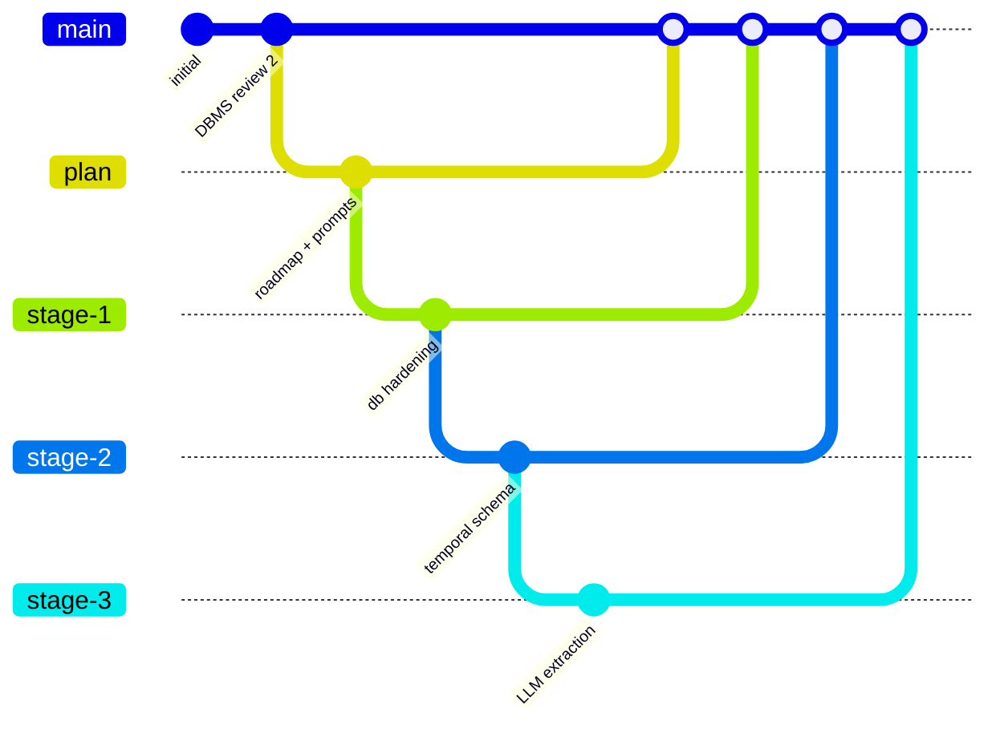
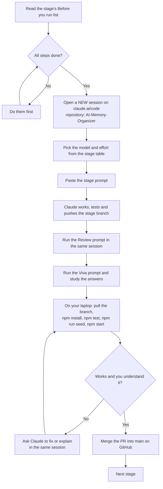
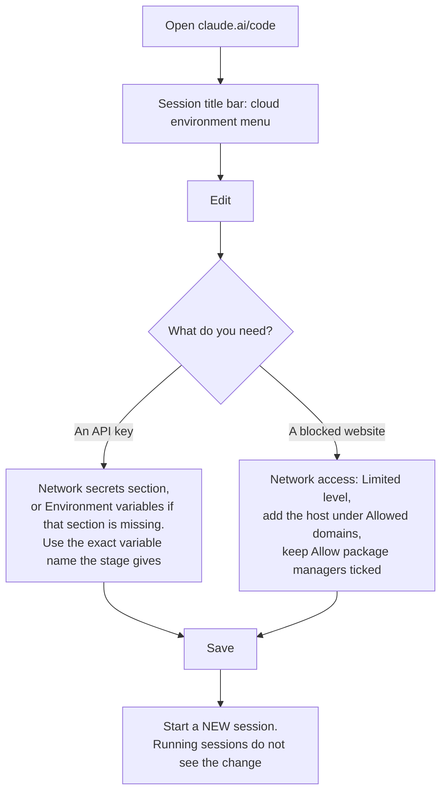
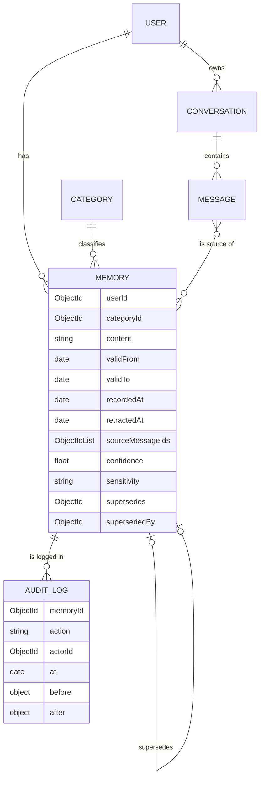
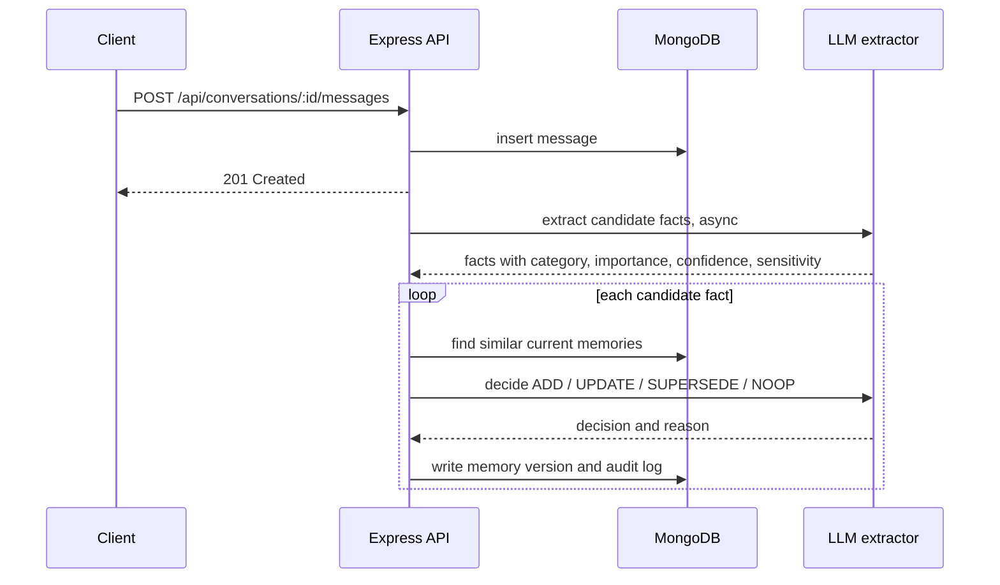
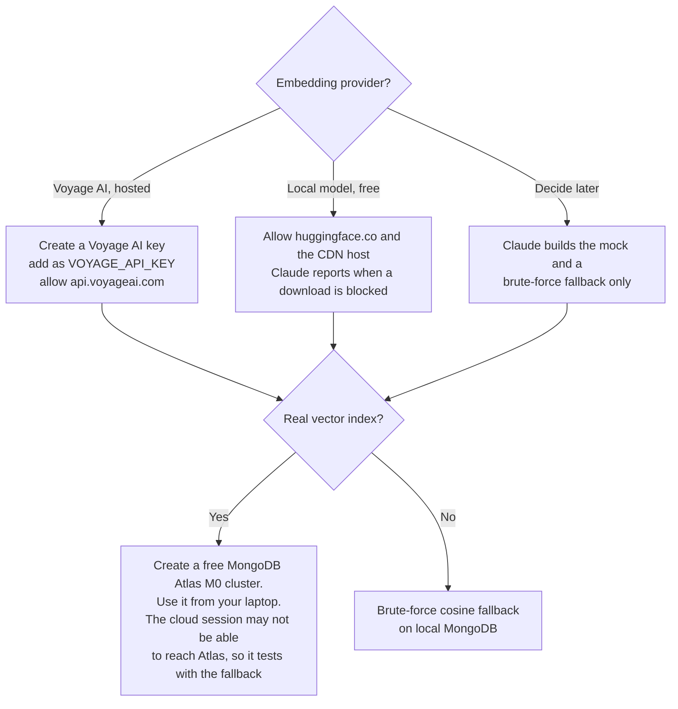
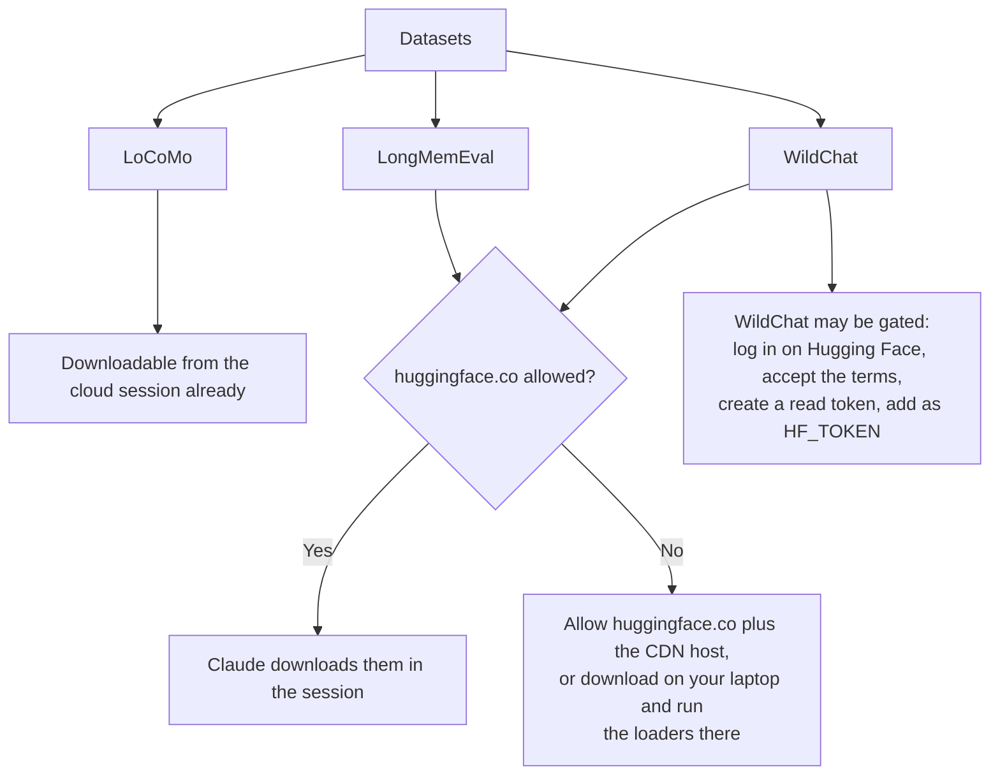
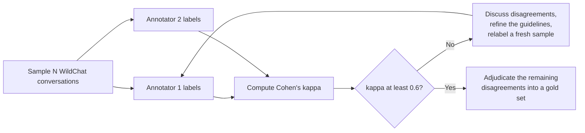
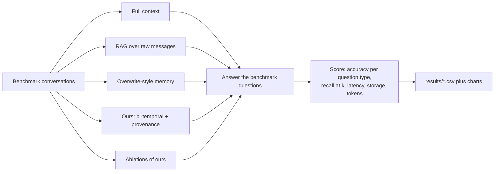

# Prompt Playbook

Copy-paste prompts for every stage in [`ROADMAP.md`](ROADMAP.md). For each stage:

1. **Before you run.** Steps only you can do. Skip a stage until they are done.
2. **Model and effort.** What to pick in the session's model picker.
3. **Prompt.** Paste it as the first message of a **new** Claude Code session
   on this repository.
4. **After it finishes.** How to check the work before merging.

The diagrams are Mermaid and render on GitHub.

---

## How the whole process fits together

### Branches



Real branch names: `plan` = `claude/laughing-lamport-d9jmok`, `stage-1` =
`claude/stage-1-db-hardening`, and so on (full list in `ROADMAP.md`). Each
stage stacks on the previous one, so Claude never has to wait for you to
merge. You merge into `main` in order.

### The loop for every stage



### Changing environment settings (keys and blocked websites)

Several stages need an API key or a website unblocked. Both are changed in
the same place:



Never paste a key into the chat or commit it to the repository.
Network-access docs: https://code.claude.com/docs/en/cloud-environments#network-access

---

## Model and effort guide

| Model | Strength | Cost (API, per 1M input / output tokens) |
|---|---|---|
| **Claude Fable 5.1** | Most capable. Deep reasoning, research design, long careful writing | $10 / $50 |
| **Claude Opus 5.5** | Strong default for hard engineering | $4 / $20 |
| **Claude Sonnet 5.5** | Fast, good for well-specified coding | $2 / $10 |
| **Claude Haiku 5.5** | Cheapest. Bulk, simple tasks | $0.10 / $0.50 |

Effort (`low` → `medium` → `high` → `xhigh` → `max`) controls how hard the
model thinks. Higher effort is slower and uses more of your plan's usage. If
your app shows no effort control, keep the default.

| Prompt | Model | Effort | Why |
|---|---|---|---|
| Stage 1: DB hardening | Sonnet 5.5 | high | Well-defined CRUD, validation and test work |
| Stage 2: Temporal schema | Opus 5.5 | high | Bi-temporal semantics are easy to get subtly wrong |
| Stage 3: LLM extraction | Opus 5.5 | xhigh | The core "AI" contribution. Reconciliation logic must be right |
| Stage 4: Hybrid retrieval | Opus 5.5 | high | Ranking design and vector-search integration |
| Stage 5: Datasets | Sonnet 5.5 | high | Parsing and loaders, with careful PII handling |
| Stage 6: Evaluation | Fable 5.1 (or Opus 5.5 at xhigh) | xhigh | Methodology mistakes invalidate the whole paper |
| Stage 7: Governance | Opus 5.5 | high | Privacy correctness, erasure must be complete |
| Stage 8: Demo UI | Sonnet 5.5 | medium | Straightforward front-end work |
| Stage 9: Paper | Fable 5.1 (or Opus 5.5 at high) | high | Long, careful, well-argued writing |
| Review prompt (every stage) | Opus 5.5 | high | A fresh, critical look at the diff |
| Viva prompt (every stage) | Sonnet 5.5 | medium | Explanations for you |
| Fix-CI / Resume prompts | Sonnet 5.5 | high | Focused repair work |

Fable 5.1 uses your plan's usage fastest. If you hit limits, use the
alternative shown.

---

## Stage 0: Plan (done)

The roadmap, `CLAUDE.md` and this playbook are on
`claude/laughing-lamport-d9jmok`.

**Before Stage 1:** open a pull request from `claude/laughing-lamport-d9jmok`
into `main` on GitHub and merge it. This step is optional, because Stage 1
already stacks on it.

---

## Stage 1: Database hardening

**Before you run**
- [ ] Nothing external is needed. Claude runs its own MongoDB in Docker.
- [ ] On your laptop, have Node 20+ and MongoDB (local or Atlas) ready so you
      can run the result.

**Model:** Sonnet 5.5 · **Effort:** high

**Prompt**
```text
Read CLAUDE.md and docs/ROADMAP.md first and follow them exactly.

Task: Stage 1 – Database hardening.
Branch: you have my explicit permission to work on and push to
`claude/stage-1-db-hardening`. It already exists on origin: check it out and
merge origin/main into it if main has moved. Never push to main.

Do all of the following:
1. Referential integrity in a service layer (services/): verify userId,
   categoryId and conversationId exist on create and update. Deleting a user
   cascades to their conversations, messages and memories. Deleting a
   category that still has memories is blocked with 409.
2. Auth: simple JWT (register/login with bcrypt-hashed passwords). Every
   memory/conversation query is scoped to the authenticated user. Remove
   unscoped listing and cross-user search. Keep the seed users working (give
   them known dev passwords, documented in README).
3. Indexes: remove the standalone userId_1 (a prefix of the compound index)
   and status_1 (low cardinality). Justify every remaining index with the
   ESR rule in a comment. Add a migration script that drops the old indexes
   from an existing database.
4. Pagination (limit + cursor on _id) on every list endpoint, max limit 100.
5. Full CRUD routes for users (self only), categories and conversations.
   Move messages into their own `messages` collection with an index on
   { conversationId, sentAt }. Update the seed script accordingly.
6. Add scripts/explain.js: prints the index list (no duplicates) and
   explain("executionStats") for the main queries. Add an npm script for it.
7. Tests: Jest + supertest against a real MongoDB (MONGO_URI_TEST), covering
   CRUD, validation errors, integrity checks, auth scoping (user A cannot see
   user B's data), pagination and the two aggregation endpoints. Fix the
   by-category aggregation so orphan categoryIds can no longer drop counts
   silently.
8. GitHub Actions CI: run the tests with a mongo:7 service container on
   every push and pull request.
9. README: what the project is, setup, env vars, every endpoint with an
   example, a Mermaid ER diagram, and how to run tests.

Acceptance: npm test passes locally against Docker mongo:7, npm run seed and
npm start work, and the explain script shows IXSCAN for the user-scoped
queries.
Do not start Stage 2 work. Do not add LLM features.

When done: commit in logical steps, push, then open a pull request from this
branch into main titled "Stage 1: Database hardening". Finally give me
(a) a summary of changes, (b) the exact commands to run it on my laptop,
(c) anything you could not do.
```

**After it finishes:** CI is green on the PR. Run the Review and Viva prompts
(end of this file). Try logging in as two seed users and confirm neither can
see the other's memories.

---

## Stage 2: Bi-temporal memory schema

**Before you run**
- [ ] Stage 1 is pushed. Merging it is not required, because Stage 2 stacks
      on it.
- [ ] Read the target schema below so you know what is coming.



**Model:** Opus 5.5 · **Effort:** high

**Prompt**
```text
Read CLAUDE.md and docs/ROADMAP.md first and follow them exactly.

Task: Stage 2 – Bi-temporal memory schema.
Branch: you have my explicit permission to create and push
`claude/stage-2-temporal-schema`. Create it from origin/main if
`claude/stage-1-db-hardening` is merged into main, otherwise from
origin/claude/stage-1-db-hardening. If it already exists on origin, check it
out and continue. Never push to main.

Implement, following the ER diagram in docs/PROMPTS.md (Stage 2):
1. Memory fields: validFrom, validTo (valid time), recordedAt, retractedAt
   (transaction time), sourceMessageIds, confidence (0–1), sensitivity
   (normal | personal | special), supersedes, supersededBy, lastAccessedAt,
   accessCount. Health facts default to sensitivity "special".
2. Updates never overwrite content: a change SUPERSEDES the old version (set
   its validTo/supersededBy, insert the new version) inside a MongoDB
   transaction. Deletion is a retraction (retractedAt), except for the hard
   erasure that Stage 7 will add.
3. "Current" queries return only versions with validTo = null and
   retractedAt = null. Add GET /api/memories/:id/history (the version chain)
   and an as-of query: GET /api/memories?asOf=<ISO date> for valid time and
   ?knownAt=<ISO date> for transaction time.
4. An append-only auditlog collection written for every create, supersede and
   retract.
5. Indexes that support current-state and as-of queries, each justified
   with ESR in a comment. Show explain() output for them in scripts/explain.js.
6. A migration script that converts existing Stage-1 data (validFrom =
   createdAt, recordedAt = createdAt) and is safe to run twice.
7. Update the seed so some memories have realistic version chains (e.g. a
   city move, a changed goal), and a README section explaining the
   bi-temporal model with one worked example.
8. Tests for supersede, history, asOf vs knownAt, transaction rollback on
   failure, and the migration.

Acceptance: all tests pass on Docker mongo:7 run as a single-node replica
set (transactions need one). Document that requirement in the README and CI.
Do not add LLM features yet.

When done: commit, push, open a PR into main titled "Stage 2: Bi-temporal
memory schema", and give me a summary, laptop commands (including how to
start MongoDB as a replica set locally) and anything you could not do.
```

**After it finishes:** Review and Viva prompts. Make sure you can explain the
difference between *valid time* and *transaction time* in your own words.
Examiners will ask.

---

## Stage 3: LLM extraction and reconciliation

**Before you run**
- [ ] Create an API key at the Anthropic Console and **set a monthly spend
      limit** there.
- [ ] Add it to the environment as `ANTHROPIC_API_KEY` (environment settings
      diagram above). Do **not** paste it in chat.
- [ ] Put the same key in your laptop's `.env` (never commit `.env`).
- [ ] Start a **new** session after saving.

What gets built:


**Model:** Opus 5.5 · **Effort:** xhigh

**Prompt**
```text
Read CLAUDE.md and docs/ROADMAP.md first and follow them exactly. Use the
claude-api skill for all Anthropic SDK code.

Task: Stage 3 – LLM extraction and reconciliation.
Branch: you have my explicit permission to create and push
`claude/stage-3-llm-extraction`. Create it from origin/main if Stage 2 is
merged, otherwise from origin/claude/stage-2-temporal-schema. If it exists
on origin, check it out and continue. Never push to main.

Implement the pipeline in the Stage 3 sequence diagram in docs/PROMPTS.md:
1. services/llm/: a provider interface with an Anthropic implementation
   (official @anthropic-ai/sdk, structured outputs for JSON, refusal
   handling) and a deterministic mock provider. Read EXTRACTION_MODEL,
   RECONCILE_MODEL and JUDGE_MODEL from env, default claude-opus-5-5.
   LLM_PROVIDER=mock|anthropic.
2. Extraction: from a new message plus recent context, return candidate
   facts {content, category, importance 1-5, confidence 0-1, sensitivity,
   validFrom if stated}. Only durable facts about the user, not chit-chat.
   Respect per-category consent if it exists (Stage 7 will add the
   settings: leave a hook).
3. Reconciliation: for each candidate, fetch similar current memories
   (text index for now; Stage 4 adds vectors) and decide ADD / UPDATE /
   SUPERSEDE / NOOP with a reason. Apply the decision through the Stage-2
   service so versioning and the audit log are reused.
4. Triggered asynchronously after POST /api/conversations/:id/messages via
   a simple job queue collection (status, attempts, error), so the API
   never blocks on the LLM. Add a worker script and npm script.
5. Prompts versioned in prompts/*.md. Every LLM call logged to an llmcalls
   collection (model, prompt version, input/output tokens, latency, cost).
6. Tests use the mock provider only (CI has no key). Add a small opt-in
   live smoke test (npm run test:live) that runs only when
   ANTHROPIC_API_KEY is set, on 3 conversations, and prints the token cost.
7. README section with the pipeline diagram and how to switch providers.

Before any live call, tell me the estimated cost of the smoke test. Run the
live test only if ANTHROPIC_API_KEY is present, and report real token usage.
Never fabricate LLM outputs in docs. If no key is available, say so and
stop at the mock.

When done: commit, push, open a PR titled "Stage 3: LLM extraction and
reconciliation", then summarize, give laptop commands, and list what you
could not do.
```

**After it finishes:** Review and Viva prompts. On your laptop, set
`LLM_PROVIDER=anthropic`, post a few real messages, and inspect the
`memories`, `auditlog` and `llmcalls` collections in Compass.

---

## Stage 4: Hybrid retrieval

**Before you run.** Pick an embedding provider:


- [ ] Add the chosen key(s) to the environment, then start a new session.
- [ ] If using Atlas, put its connection string in your laptop `.env` as
      `MONGO_URI` (not in the cloud environment unless Claude asks).

**Model:** Opus 5.5 · **Effort:** high

**Prompt**
```text
Read CLAUDE.md and docs/ROADMAP.md first and follow them exactly.

Task: Stage 4 – Hybrid retrieval.
Branch: you have my explicit permission to create and push
`claude/stage-4-hybrid-retrieval`, from origin/main if Stage 3 is merged,
otherwise from origin/claude/stage-3-llm-extraction. If it exists on origin,
check it out and continue. Never push to main.

My embedding choice: <voyage | local | decide later>. Atlas: <yes | no>.

Implement:
1. services/embeddings/: provider interface plus the provider above and a
   deterministic mock. An embedding is stored on each memory version, and a
   backfill script embeds existing memories.
2. Vector search: Atlas $vectorSearch (with the index definition committed
   as JSON and the setup steps documented) when VECTOR_BACKEND=atlas, and a
   brute-force cosine fallback over the user's current memories when
   VECTOR_BACKEND=local. Same interface.
3. Hybrid ranking: score = w1*text + w2*vector + w3*recency + w4*importance,
   with weights in config, restricted to memories valid at the query's
   asOf time (default now). Also bump lastAccessedAt and accessCount.
4. POST /api/ask {question, asOf?}: retrieve top-k memories, answer with
   the LLM, and return the answer plus the cited memory ids. Mock in tests.
5. Reconciliation from Stage 3 now uses vector similarity to find
   candidates.
6. Tests for ranking order, asOf filtering, and fallback/atlas parity on
   the mock. Add a retrieval benchmark script that reports latency
   p50/p95 at 1k and 10k synthetic memories (labelled synthetic) and writes
   to results/.

If a host is blocked, tell me the exact host. Do not fake embeddings
outside the mock.

When done: commit, push, open a PR titled "Stage 4: Hybrid retrieval", then
summarize, give laptop commands (including the Atlas index setup), and list
what you could not do.
```

**After it finishes:** Review and Viva prompts. On your laptop, ask
`/api/ask` a question whose answer changed over time (for example "Where do I
live?") with and without `asOf`.

---

## Stage 5: Real datasets

**Before you run**


- [ ] Read each dataset's license and terms of use yourself and accept them
      in your own name.
- [ ] Decide how many WildChat conversations to annotate (300 is a good
      target for two annotators).
- [ ] Datasets are **not** committed to Git (size and personal data). Claude
      will add them to `.gitignore`.

**Model:** Sonnet 5.5 · **Effort:** high

**Prompt**
```text
Read CLAUDE.md and docs/ROADMAP.md first and follow them exactly.

Task: Stage 5 – Real datasets.
Branch: you have my explicit permission to create and push
`claude/stage-5-datasets`, from origin/main if Stage 2 is merged, otherwise
from the latest stage branch that exists on origin. If it exists on origin,
check it out and continue. Never push to main.

Implement:
1. data/ (gitignored) plus scripts/datasets/download.js for LoCoMo
   (github raw), LongMemEval and WildChat (Hugging Face, HF_TOKEN if set).
   If a host is blocked, report the exact host and continue with the rest.
2. Loaders that map each dataset into users / conversations / messages
   with a `dataset` field (`benchmark` or `real`) and the original ids. Keep
   the benchmark QA labels in a separate `evalitems` collection.
3. PII scrubbing for WildChat before insertion (emails, phones, URLs,
   names where detectable), with a report of what was redacted. Never
   print raw WildChat text in logs.
4. A sampler that picks N WildChat conversations (seeded, reproducible)
   for annotation.
5. An annotation tool (minimal web page served by Express, or a CLI) where
   a logged-in annotator marks, for each message, the facts that should be
   remembered, plus category and sensitivity. Two annotators label
   independently. Labels are stored with annotatorId. Write
   docs/ANNOTATION_GUIDELINES.md with clear rules and examples.
6. scripts/agreement.js computes Cohen's kappa between annotators.
7. A synthetic scale generator (10k / 100k / 1M memories), every document
   marked dataset: synthetic, for performance tests only.
8. docs/DATASETS.md: source, license, citation, what was loaded, counts
   (from a real run), and limitations of each dataset.

Do not create annotations yourself. If you pre-label, store them with
annotatorId "model" and never count them as human labels.

When done: commit, push, open a PR titled "Stage 5: Real datasets", then
summarize, give laptop commands, and list what you could not do.
```

**After it finishes: human annotation sprint (you, not Claude)**


If you also run a user study with real people's chats, get approval from
your institution's ethics committee **before** collecting anything, and
collect signed consent.

---

## Stage 6: Evaluation

**Before you run**
- [ ] Stages 3–5 merged or pushed. LongMemEval/LoCoMo loaded. The gold
      annotation set exists if you want extraction precision and recall.
- [ ] Decide the budget. Claude will run a 10-item pilot first and tell you
      the projected full cost before spending it.
- [ ] Set the API console spend limit to match.



**Model:** Fable 5.1 (or Opus 5.5) · **Effort:** xhigh

**Prompt**
```text
Read CLAUDE.md and docs/ROADMAP.md first and follow them exactly. Use the
claude-api skill for API code and the dataviz skill for charts.

Task: Stage 6 – Evaluation.
Branch: you have my explicit permission to create and push
`claude/stage-6-evaluation`, from origin/main if Stages 4 and 5 are merged,
otherwise merge origin/claude/stage-4-hybrid-retrieval and
origin/claude/stage-5-datasets into a new branch. If it exists on origin,
check it out and continue. Never push to main.

Build an evaluation harness (eval/):
1. Systems: (a) full context, (b) RAG over raw messages, (c) overwrite-style
   memory (same pipeline with SUPERSEDE replaced by in-place UPDATE and no
   history), (d) ours, (e) ours without temporal fields, (f) ours without
   provenance. Same answer model and prompt for all.
2. Benchmarks: LongMemEval (report per question type, especially
   knowledge-update and temporal-reasoning) and LoCoMo QA. Use the official
   scoring where the benchmark defines one. Otherwise use an LLM judge with
   a fixed rubric, and validate the judge on 50 items against my manual
   labels (export a CSV for me to label).
3. Extraction quality: precision/recall/F1 of extraction vs. the human gold
   set from Stage 5, if present.
4. Systems metrics: p50/p95 latency, storage bytes per user, tokens and cost
   per question.
5. DBMS experiment: index vs. no-index explain("executionStats") and
   wall-clock at 10k / 100k / 1M synthetic memories for the main queries.
6. Every run writes results/<run-id>/ with config, git commit, dataset,
   command, raw outputs and summary CSVs. Charts are generated only from
   those CSVs. Bootstrap 95% confidence intervals for accuracy differences.

Process: first run a pilot on 10 items per benchmark, report the measured
cost and projected full cost, and WAIT for my go-ahead before the full run.
Report all results honestly, including where ours loses. Write
docs/RESULTS.md with tables, charts and a limitations section.

When done: commit, push, open a PR titled "Stage 6: Evaluation", then
summarize the results and list what you could not do.
```

**After it finishes:** label the 50-item judge-validation CSV yourself. Check
`docs/RESULTS.md` numbers against the CSVs in `results/`.

---

## Stage 7: Privacy and governance

**Before you run**
- [ ] Stage 2 merged or pushed (Stage 7 only needs the temporal schema).
- [ ] Optional: ask your guide which regulation to emphasise (India's DPDP
      Act 2023 is the natural choice, GDPR for comparison).

**Model:** Opus 5.5 · **Effort:** high

**Prompt**
```text
Read CLAUDE.md and docs/ROADMAP.md first and follow them exactly.

Task: Stage 7 – Privacy and governance.
Branch: you have my explicit permission to create and push
`claude/stage-7-governance`, from origin/main if Stage 2 is merged,
otherwise from the latest stage branch on origin. If it exists on origin,
check it out and continue. Never push to main.

Implement:
1. Consent settings per user and category (store / ask / never), enforced
   in the extraction hook from Stage 3 if present, otherwise at the memory
   service.
2. Lineage-based hard erasure: deleting a message or conversation erases
   every memory version derived only from it (via sourceMessageIds), plus
   its embeddings. Memories that also have other sources are re-derived or
   flagged. Audit-log entries are tombstoned, keeping action and time but
   no content. Add an erasure verification script proving nothing derived
   remains.
3. GET /api/me/export: everything stored about the user as JSON.
4. Retention policy: special-sensitivity memories expire after a
   configurable period (TTL or scheduled job). Explain the choice.
5. docs/PRIVACY.md mapping each feature to DPDP Act 2023 sections and GDPR
   Art. 9 / 17 / 20, with "TODO: verify" on anything you are unsure of.
6. Tests for consent blocking, complete erasure, export completeness and
   retention.

When done: commit, push, open a PR titled "Stage 7: Privacy and
governance", then summarize, give laptop commands, and list what you could
not do.
```

**After it finishes:** have someone (your guide or a classmate) check
`docs/PRIVACY.md` against the actual DPDP Act text.

---

## Stage 8: Demo UI (optional)

**Before you run:** Stage 4 is pushed. Decide whether the demo is worth the
time compared with polishing the evaluation.

**Model:** Sonnet 5.5 · **Effort:** medium

**Prompt**
```text
Read CLAUDE.md and docs/ROADMAP.md first and follow them exactly.

Task: Stage 8 – Demo UI.
Branch: you have my explicit permission to create and push
`claude/stage-8-ui`, from origin/main if Stage 4 is merged, otherwise from
the latest stage branch on origin. Never push to main.

Build a small React (Vite) app in client/: login, chat with a conversation,
a memory panel grouped by category, a timeline per memory showing
superseded versions, an "as of" date slider, a consent/erasure settings
page, and an /ask box that shows cited memories. Proxy to the Express API.
Keep it simple and accessible. Use the run skill to launch it and take
screenshots of each screen into docs/screenshots/.

When done: commit, push, open a PR titled "Stage 8: Demo UI", then
summarize and give laptop commands.
```

---

## Stage 9: Paper and review documents

**Before you run**
- [ ] Stage 6 results exist and you have checked them.
- [ ] Gather the review template or format your department requires, and
      upload it in the session if there is one.
- [ ] Check your institution's rules on disclosing AI assistance.

**Model:** Fable 5.1 (or Opus 5.5) · **Effort:** high

**Prompt**
```text
Read CLAUDE.md, docs/ROADMAP.md and docs/RESULTS.md first and follow them.

Task: Stage 9 – Paper and review documents.
Branch: you have my explicit permission to create and push
`claude/stage-9-paper`, from origin/main if Stage 6 is merged, otherwise
from origin/claude/stage-6-evaluation. Never push to main.

Write in docs/paper/ (Markdown):
1. Abstract, introduction with the research question, related work (Mem0,
   MemGPT/Letta, Zep/Graphiti, A-Mem, LangMem, LongMemEval, LoCoMo:
   verify every citation's authors, venue and year by web search, and
   mark any you cannot verify), system design with diagrams, the
   bi-temporal model, evaluation setup, results (only numbers from
   results/), ablations, limitations, ethics/privacy, and future work.
2. A references.bib.
3. A Review-3 document as .docx (use the docx skill), following the
   template I uploaded if any, with real screenshots and result tables.
4. A 10-slide outline for the presentation.
Every number must cite the results/ file it came from. Do not overstate
results.

When done: commit, push, open a PR titled "Stage 9: Paper and review
documents", then list every claim you could not verify.
```

**After it finishes:** rewrite the paper in your own voice. You must be able
to defend every sentence in it.

---

## Follow-up prompts (use in the same session after any stage)

**Review.** Model: Opus 5.5 · Effort: high. Paste:
```text
/code-review high
```
Then:
```text
Fix every correctness finding from that review, rerun the tests, and push.
List anything you chose not to fix and why.
```

**Viva preparation.** Model: Sonnet 5.5 · Effort: medium.
```text
Explain this stage to me as if I must defend it in a viva tomorrow:
1) what changed and why, file by file, in plain language;
2) the database concepts involved (with the textbook term for each);
3) 10 questions an examiner is likely to ask, with short model answers;
4) the 3 weakest points of this stage and how I should answer if asked.
```

**Fix failing CI.** Model: Sonnet 5.5 · Effort: high.
```text
CI is failing on the PR for <branch>. Reproduce the failure locally first,
find the root cause, fix it without skipping or disabling any test, rerun the
full test suite, and push. Explain the cause in two sentences.
```

**Resume an unfinished stage** (session ended midway). Model: same as the
stage.
```text
Read CLAUDE.md, docs/ROADMAP.md and docs/PROMPTS.md. Stage <N> was started
on branch <branch> but not finished. Check out that branch, compare what
exists against the Stage <N> prompt in docs/PROMPTS.md, list what is done
and what is missing, then finish the missing parts with the same rules.
```

**Merge a stacked branch after its parent merged.** Model: Sonnet 5.5 ·
Effort: medium.
```text
<parent branch> has been merged into main. On <branch>, merge origin/main
(no rebase, no force-push), resolve any conflicts, rerun the tests, and
push.
```
